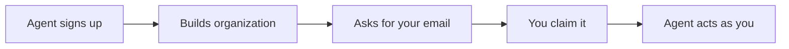

A coding agent can sign up for Polar without you. It registers itself, creates an organization, sets up products and checkout, and then hands everything to you with a claim code. You only need an account at the end.

The agent follows the instructions at [`polar.sh/auth.md`](https://polar.sh/auth.md). Point your agent there:

```text Prompt
Sign up for Polar following https://polar.sh/auth.md, then add a Pro plan and a checkout to this app.
```



<Visibility for="agents">
  The flow: anonymous registration at the identity endpoint, a one-hour access token from the token endpoint with the JWT bearer grant, then a claim started with the user's email and polled at the token endpoint. Read https://polar.sh/auth.md for the exact requests, error codes and polling rules. It is the source of truth.
</Visibility>

## How it works

<Steps>
  <Step title="The agent signs up">
    The agent registers anonymously with a name you'll see later. It gets an identity assertion (valid 30 days) and a claim token (valid 30 days, returned once).
  </Step>
  <Step title="The agent builds">
    The agent exchanges its assertion for an access token that lasts one hour, and repeats that when it expires. It creates one organization and sets it up.
  </Step>
  <Step title="The agent asks for your email">
    When it's done, the agent asks for your email and starts a claim. It gives you a link and a three-word code, like `amber-river-lemon`.
  </Step>
  <Step title="You claim it">
    You open the link, sign in or create an account with that email, and enter the code. The organization becomes yours.
  </Step>
</Steps>

## What the agent can do before you claim it

An agent can create **one** organization. Until you claim it, it can only set up the catalog:

| Can | Can't |
| --- | --- |
| Products, benefits and discounts | Customers, orders and subscriptions |
| Files and meters | Refunds and payouts |
| Events | Members |
| Checkout Sessions and Checkout Links | Webhook endpoints |
| Read custom fields | Organization access tokens |

The organization can't take payments until you claim it and pass the [account review](/merchant-of-record/account-reviews).

## Claim the agent

The agent gives you a link and a code in one message, for example:

> Open this link, sign in to Polar with jane@example.com, and enter this code: **amber-river-lemon**

1. Open the link. It goes to **Finish setup** in the Polar dashboard.
2. Sign in, or create an account, with the email the agent asked for. Only that account can claim it.
3. Enter the code under **Claim code** and click **Complete setup**.

The dashboard shows the organization and the products the agent created, then opens the organization.

<Warning>
  Completing setup lets the agent act on your behalf on Polar, in **all** your organizations, not only the one it created. Claim only agents you trust. To limit an agent to one organization, connect it with an [organization access token](/integrate/oat) instead.
</Warning>

The link and code expire after 7 days. The agent can start a new claim to get a new pair, as long as its claim token is valid (30 days after signup). After that, it has to sign up again.

## After the claim

The agent receives a new identity assertion and an access token for your account. Everything issued to it before the claim stops working. It keeps using one-hour access tokens from then on.

If the agent loses access, connect it another way: the [MCP server](/integrate/mcp) or the [Polar CLI](/integrate/cli/authentication).

## Learn more

| Resource | Description |
| --- | --- |
| [`auth.md`](https://polar.sh/auth.md) | The exact requests, responses and error codes, written for agents |
| [Build with agents](/agents/overview) | Other ways to connect an agent to Polar |
| [Account reviews](/merchant-of-record/account-reviews) | What happens before the organization can take payments |
| [Access tokens](/integrate/oat) | Give an agent access to one organization only |
