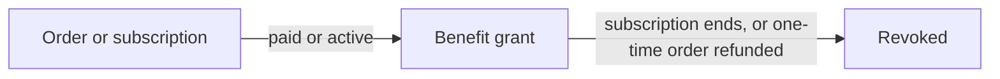

A **benefit** is something a customer receives when they buy a product: a license key, a file, access to a private repository, usage credits. Other platforms call these **entitlements**.

Benefits are standalone objects. You create a benefit once and attach it to as many products as you like. Changing the benefit updates it everywhere.

## Benefit types

| Type | What the customer gets |
| --- | --- |
| [License Keys](/features/benefits/license-keys) | A unique key, with optional activation limits and expiry |
| [File Downloads](/features/benefits/file-downloads) | Files to download from the Customer Portal |
| [GitHub Repository Access](/features/benefits/github-access) | An invitation to a private repository |
| [Discord Invite](/features/benefits/discord-access) | An invitation to a server, with roles |
| [Shared Slack Channel](/features/benefits/slack-shared-channel) | A Slack Connect channel with your team |
| [Feature Flag](/features/benefits/feature-flags) | A flag, with metadata, that your application checks |
| [Meter Credits](/features/usage-based-billing/credits) | Units credited to a [meter](/concepts/usage) |
| [Custom](/features/benefits/custom) | Anything else, delivered by you |

## Grants

When a customer gets a benefit, Polar creates a **benefit grant**: the record that this customer holds this benefit, and why.

- A **one-time purchase** grants its benefits for good, unless you revoke them when refunding the order.
- A **subscription** grants them while it's `active` or `trialing`, and revokes them when it ends.
- With [seat-based pricing](/features/seat-based-pricing), each team member who claims a seat gets their own grants.

Polar delivers the benefit automatically. It generates the license key, sends the GitHub invitation or adds the Discord role, and removes access again on revocation.

## Checking access in your application

Most benefits work without any code. For the ones your application enforces, like feature flags or credits, read the customer's granted benefits from the [customer state](/integrate/customer-state).

## From the CLI or your agent

Every task here also works from your terminal and your agent. See the [CLI reference](/integrate/cli/reference) and the [MCP server](/integrate/mcp).

| Task | CLI | MCP operation |
| --- | --- | --- |
| Create a benefit | `polar benefits create` | `benefits_create` |
| List who holds a benefit | `polar benefits grants <id>` | `benefits_grants` |
| List grants across customers | `polar benefit_grants list` | `benefit_grants_list` |

## Learn more

| Resource | Description |
| --- | --- |
| [Benefits](/features/benefits/introduction) | Create and manage benefits |
| [Customer state](/integrate/customer-state) | Read a customer's granted benefits in one call |
| [Benefits API](/api-reference/current/benefits/list-benefits) | Manage benefits programmatically |
| [Benefit grants API](/api-reference/current/benefit-grants/list-benefit-grants) | List grants across customers |
