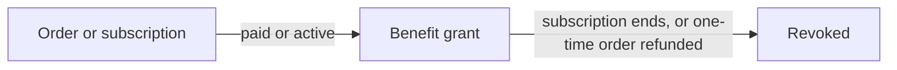

A **benefit** is something a customer receives from you: usage credits, a feature flag, a shared Slack channel, a license key. Customers get benefits automatically when they buy a product, and you can also grant them to any customer directly, without a purchase. Other platforms call these **entitlements**.

Benefits are standalone objects. You create a benefit once and attach it to as many products as you like. Changing the benefit updates it everywhere.

## Benefit types

| Type | What the customer gets |
| --- | --- |
| [Meter Credits](/features/usage-based-billing/credits) | Units credited to a [meter](/concepts/usage) |
| [Feature Flag](/features/benefits/feature-flags) | A flag, with metadata, that your application checks |
| [Shared Slack Channel](/features/benefits/slack-shared-channel) | A Slack Connect channel with your team |
| [Custom](/features/benefits/custom) | Anything else, delivered by you |
| [License Keys](/features/benefits/license-keys) | A unique key, with optional activation limits and expiry |
| [File Downloads](/features/benefits/file-downloads) | Files to download from the Customer Portal |
| [GitHub Repository Access](/features/benefits/github-access) | An invitation to a private repository |
| [Discord Invite](/features/benefits/discord-access) | An invitation to a server, with roles |

## Grants

When a customer gets a benefit, Polar creates a **benefit grant**: the record that this customer holds this benefit, and why. A grant comes from a purchase or from you granting it directly.

- A **one-time purchase** grants its benefits for good, unless you revoke them when refunding the order.
- A **subscription** grants them while it's `active` or `trialing`, and revokes them when it ends.
- With [seat-based pricing](/features/seat-based-pricing), each team member who claims a seat gets their own grants.
- A **manual grant** gives a customer a benefit without any order: a trial of a feature, a goodwill gesture, a deal agreed outside checkout. It lasts until you revoke it. See [Grant or revoke a benefit manually](/features/benefits/introduction#grant-or-revoke-a-benefit-manually).

Polar delivers integrated benefits automatically. It generates the license key, sends the GitHub invitation or adds the Discord role, and removes access again on revocation. Custom benefits are delivered by you, and your application enforces feature flags and credits.

## Checking access in your application

Most benefits work without any code. For the ones your application enforces, like feature flags or credits, read the customer's granted benefits from the [customer state](/integrate/customer-state).

## In the dashboard, CLI or your agent

Benefits live under **Catalog → Benefits** in the dashboard. The same tasks work from your terminal and your agent. See the [CLI reference](/integrate/cli/reference) and the [MCP server](/integrate/mcp).

| Task | Dashboard | CLI | MCP operation |
| --- | --- | --- | --- |
| Create a benefit | **Catalog → Benefits → Create Benefit** | `polar benefits create` | `benefits_create` |
| List who holds a benefit | **Benefit Grants** on the benefit's page | `polar benefits grants <id>` | `benefits_grants` |
| List grants across customers | Per benefit only | `polar benefit_grants list` | `benefit_grants_list` |

## Learn more

| Resource | Description |
| --- | --- |
| [Benefits](/features/benefits/introduction) | Create and manage benefits |
| [Customer state](/integrate/customer-state) | Read a customer's granted benefits in one call |
| [Benefits API](/api-reference/current/benefits/list-benefits) | Manage benefits programmatically |
| [Benefit grants API](/api-reference/current/benefit-grants/list-benefit-grants) | List grants across customers |
