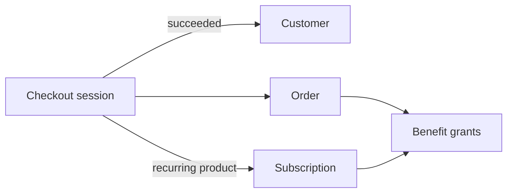

**Checkout** is where a customer picks a product, enters their payment and billing details, and pays. Polar hosts the checkout page, calculates tax for the customer's location, and handles the payment.

Every purchase goes through a **checkout session**: a short-lived object holding one purchase attempt. There are two ways to create one.

## Checkout Links and Checkout Sessions

| | Checkout Link | Checkout Session |
| --- | --- | --- |
| **Created** | Once, in the dashboard or API | Per purchase, from your backend |
| **Lifetime** | Permanent URL you can share anywhere | Expires if not completed |
| **Code needed** | None | An API call |
| **Best for** | Websites, emails, social posts | Signed-in users, per-customer data |

A Checkout Link is a reusable URL that creates a fresh checkout session each time someone opens it. Always share the link, never the session URL behind it.

Create a Checkout Session yourself when you know who the customer is. Pass their `external_customer_id`, prefill their email, or attach metadata, then redirect them to the session's `url`.

You can offer several products in one checkout. The customer picks one of them; products aren't bundled into a single order.

## What a checkout creates

When the checkout succeeds, Polar:

1. Finds or creates the [customer](/concepts/customers).
2. Creates an [order](/concepts/orders-and-subscriptions) for the payment.
3. Creates a subscription, if the product is recurring.
4. Grants the product's [benefits](/concepts/benefits).

A session moves through the statuses `open`, `confirmed`, and then `succeeded` or `failed`. Sessions that are never completed become `expired`.

## Customizing checkout

- **Discounts** can be preset on a link or session, or entered by the customer as a code. See [Discounts](/features/discounts).
- **Custom fields** collect extra information, like a company name or a terms checkbox. See [Custom fields](/features/custom-fields).
- **Ad-hoc prices** set a price for a single session without changing your catalog. See [Ad-hoc prices](/features/checkout/session#ad-hoc-prices).
- **Embedded checkout** opens the checkout on your own site instead of redirecting. See [Embedded checkout](/features/checkout/embed).

## From the CLI or your agent

Checkout Sessions are created from your backend with the SDK or API. Checkout Links also work from the CLI or your agent:

| Task | CLI | MCP operation |
| --- | --- | --- |
| Create a Checkout Link | `polar checkout_links create` | `checkout_links_create` |
| List checkout sessions | `polar checkouts list` | `checkouts_list` |

## Learn more

| Resource | Description |
| --- | --- |
| [Checkout Links](/features/checkout/links) | Create and share no-code checkout URLs |
| [Checkout API](/features/checkout/session) | Create checkout sessions from your backend |
| [Payment methods](/features/checkout/payment-methods) | Payment methods available at checkout |
| [Create Checkout Session API](/api-reference/current/checkouts/create-checkout-session) | API reference |
