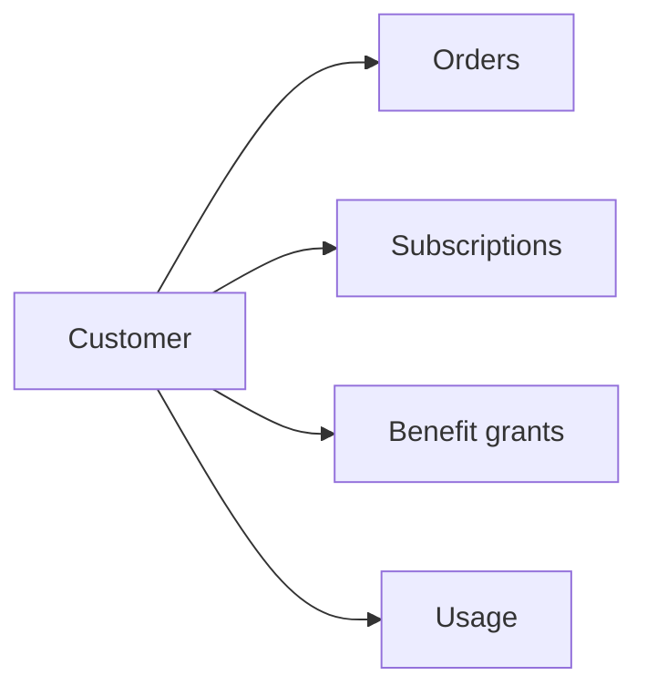

A **customer** is the person or team that buys from you. Everything they do on Polar hangs off the customer: orders, subscriptions, benefit grants, usage and payment methods.

Polar creates a customer automatically when someone completes a checkout. You can also create customers in advance through the API, for example when a user signs up in your application.

## External ID

Your application already has its own user IDs. Set a customer's **`external_id`** to your user's ID, and you never need to store Polar's customer ID.

- It's unique within your organization and can't be changed once set.
- Most customer endpoints have a variant that takes the external ID instead of Polar's ID.
- Pass `external_customer_id` when creating a [checkout session](/concepts/checkout) or [ingesting events](/concepts/usage) to attach them to the right customer.

## Customer state

The **customer state** is a single object with everything you need to decide what a customer can access:

- The customer's details
- Their **active** subscriptions
- Their **granted** benefits
- Their **active** meters, with current balances

Fetch it when you need it, or listen to the `customer.state_changed` webhook to be told whenever it changes. See [Customer state](/integrate/customer-state).

## Individuals and teams

A customer is an **individual** by default. When a customer buys a [seat-based product](/features/seat-based-pricing), they become a **team**, which separates who pays from who uses the product:

- The **customer** is the billing entity. It owns orders, subscriptions and payment methods.
- **Members** are the people under the customer. Each has a role (`owner`, `billing_manager` or `member`) and receives their own benefit grants.
- A **seat** assigns a product to a member.

For team customers, identify the end user by their member, not by the customer who paid.

## Customer portal

Customers manage their own billing in the [customer portal](/features/customer-portal/introduction): they can update payment methods, download invoices, view usage, and cancel or change their subscriptions. They sign in with their email, or you can send them in with a [customer session](/api-reference/current/customer-sessions/create-customer-session) from your application.

## Learn more

| Resource | Description |
| --- | --- |
| [Customer management](/features/customer-management) | View and edit customers, external IDs and metadata |
| [Customer state](/integrate/customer-state) | Everything a customer has access to, in one call |
| [Seat-based pricing](/features/seat-based-pricing) | Teams, members and seats |
| [Customers API](/api-reference/current/customers/list-customers) | Manage customers programmatically |
