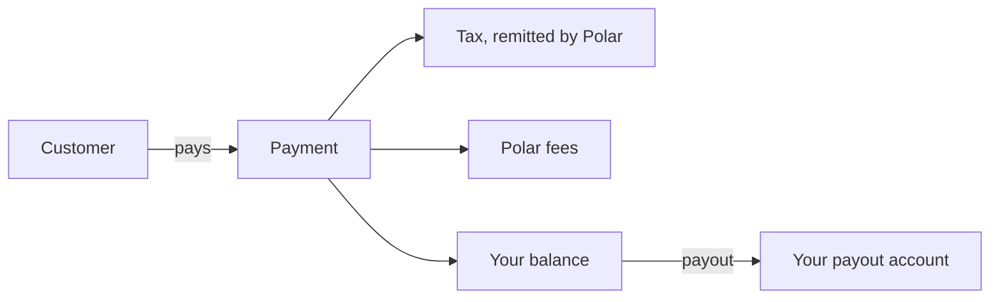

As your [Merchant of Record](/merchant-of-record/introduction), Polar collects every payment, pays the tax, and passes the rest on to you:

## Payments

A **payment** is one attempt to charge a customer for an [order](/concepts/orders-and-subscriptions). An order can have several payments, for example when a renewal fails and Polar retries it.

Polar calculates the tax for each customer's location at checkout, collects it, and remits it to the tax authorities.

## Balance

Your **balance** is what you've earned, after:

1. Tax collected for remittance
2. Polar's [fees](/merchant-of-record/fees), which depend on your plan

Balances are kept in USD. Payments in other currencies are converted at the time of the transaction. See [Balance](/features/finance/balance).

## Payouts

A **payout** moves your balance to your **payout account**, a Stripe Connect Express account linked to your bank. You need a payout account before Polar can accept payments on your behalf.

New transactions are held for a settlement delay before they can be paid out, and each payout currency has a minimum amount. See [Payouts](/features/finance/payouts).

## Refunds and disputes

A **refund** returns all or part of an order's amount to the customer, along with the matching tax. Payment processing fees aren't returned. Polar may also refund an order itself to head off a likely chargeback. See [Refunds](/features/refunds).

A **dispute**, or chargeback, is when a customer asks their bank to reverse a payment. Each dispute has a fee, deducted from your balance whatever the outcome. See [Fees](/merchant-of-record/fees).

## Learn more

| Resource | Description |
| --- | --- |
| [Merchant of Record](/merchant-of-record/introduction) | What being the seller of record means |
| [Fees](/merchant-of-record/fees) | Plans, transaction fees and additional fees |
| [Balance](/features/finance/balance) · [Payouts](/features/finance/payouts) · [Payout accounts](/features/finance/accounts) | Your earnings and how to withdraw them |
| [Refunds](/features/refunds) | Full and partial refunds |
