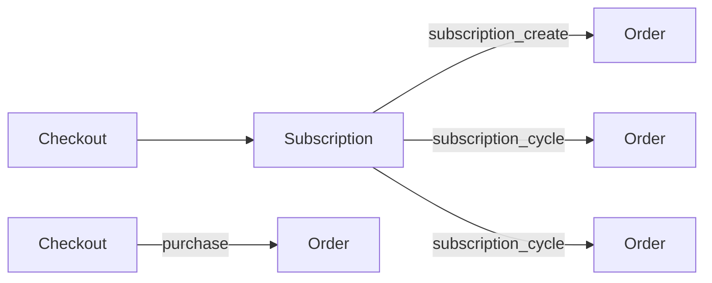

An **order** is the record of a single charge: the amount, the tax, the invoice, and the product and customer it belongs to.

A **subscription** is the ongoing relationship created when a customer buys a recurring product. It renews on every billing cycle, and each renewal creates a new order.

## Orders

Polar creates an order whenever it charges a customer. The order's `billing_reason` tells you why:

| `billing_reason` | When |
| --- | --- |
| `purchase` | A one-time product is bought |
| `subscription_create` | A subscription starts |
| `subscription_cycle` | A subscription renews |
| `subscription_update` | A plan or seat change is charged right away |
| `subscription_meter_cycle` | Usage is billed at the end of a meter period |

| Status | Meaning |
| --- | --- |
| `draft` | Created for an [off-session charge](/features/off-session-charges) and not charged yet |
| `pending` | Polar is collecting the payment |
| `paid` | The payment succeeded |
| `refunded` | Fully refunded |
| `partially_refunded` | Part of the amount was refunded |
| `void` | Won't be collected, for example after every payment retry failed |

Every paid order has a receipt, and you or the customer can generate an invoice for it.

You can also charge an existing customer outside of checkout by creating a draft order and finalizing it. See [Off-session charges](/features/off-session-charges).

## Subscriptions

A subscription follows the billing interval of its product. At the end of each period, Polar starts a new one, creates an order, and charges the customer's saved payment method. By default, metered usage from the period that just ended is billed on the same order.

| Status | Meaning | Benefits |
| --- | --- | --- |
| `trialing` | In a free [trial](/features/subscriptions/trials) | Granted |
| `active` | Paid and renewing | Granted |
| `past_due` | A renewal payment failed and Polar is [retrying it](/features/subscriptions/failed-payments) | Revoked, unless you set a grace period |
| `paused` | [Paused](/features/subscriptions/manage#pause-and-resume), no orders are created | Revoked |
| `trial_ended` | The trial ended without a payment method on file | Revoked |
| `canceled` | Ended, including after payment retries run out | Revoked |
| `incomplete` | Being created, the first payment isn't confirmed yet | Not granted |

Treat the less common `incomplete_expired` and `unpaid` statuses as ended subscriptions.

A subscription that's canceled **at period end** stays `active` until `current_period_end`, and can be uncanceled until then. A **revoked** subscription ends immediately.

## Changing a subscription

You and your customers can switch a subscription to another product, change its seats or units, apply a discount or move its billing date. Charges for a change mid-period are [prorated](/features/subscriptions/proration): either added to the next order or invoiced right away.

## From the CLI or your agent

Every task here also works from your terminal and your agent. See the [CLI reference](/integrate/cli/reference) and the [MCP server](/integrate/mcp).

| Task | CLI | MCP operation |
| --- | --- | --- |
| List orders | `polar orders list` | `orders_list` |
| Get an order's invoice | `polar orders invoice <id>` | `orders_invoice` |
| Change a subscription | `polar subscriptions update <id>` | `subscriptions_update` |
| End a subscription now | `polar subscriptions revoke <id>` | `subscriptions_revoke` |

## Learn more

| Resource | Description |
| --- | --- |
| [Orders](/features/orders) | Invoices, receipts and billing details |
| [Subscriptions](/features/subscriptions/introduction) | How subscriptions renew and end |
| [Managing subscriptions](/features/subscriptions/manage) | Change, pause, cancel and revoke |
| [Refunds](/features/refunds) | Full and partial refunds |
| [Orders API](/api-reference/current/orders/list-orders) · [Subscriptions API](/api-reference/current/subscriptions/list-subscriptions) | API reference |
