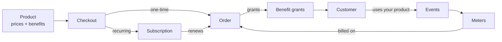

Polar is the seller of record for your software. You define what you sell, Polar runs checkout, billing and tax compliance, and your application reads back what each customer has access to.

Everything in Polar is built from a small set of objects. Understanding how they relate makes every other part of the docs easier to follow.

## Products

A [product](/concepts/products) is anything you sell: a one-time purchase or a recurring plan. Each product has **prices**, which define how much the customer pays, and **benefits**, which define what they get.

## Benefits

[Benefits](/concepts/benefits) are what a customer receives when they buy a product: a license key, a file download, access to a GitHub repository, usage credits, and more. Polar grants them automatically when a purchase succeeds and revokes them when access ends.

## Customers

A [customer](/concepts/customers) is the person or team that buys from you. You link each customer to the user in your own application with an **external ID**, and read everything they have access to from a single **customer state** object.

## Checkout

[Checkout](/concepts/checkout) is how a customer buys a product. Share a no-code Checkout Link, or create a Checkout Session from your backend. A completed checkout creates the customer, the order, and the subscription if the product is recurring.

## Orders & subscriptions

Every charge is an [order](/concepts/orders-and-subscriptions). A **subscription** is the recurring relationship behind a recurring product: it renews on each billing cycle and creates a new order every time.

## Usage

To bill for [usage](/concepts/usage), send **events** from your application. **Meters** aggregate those events into usage per customer, which you can charge for with a metered price or draw down from prepaid credits.

## Money flow

Polar is the [Merchant of Record](/merchant-of-record/introduction). Customers pay Polar, Polar remits sales tax and VAT, and the rest goes to your balance, ready to be paid out. See [Money flow](/concepts/money-flow).

## Putting it together

A typical integration follows four steps:

<Steps>
  <Step title="Model your catalog">
    Create [products](/concepts/products) with their prices, and attach the
    [benefits](/concepts/benefits) customers should get. Do this in the
    dashboard or through the API.
  </Step>
  <Step title="Sell through checkout">
    Send customers to a [Checkout Link](/features/checkout/links), or create a
    [Checkout Session](/features/checkout/session) from your backend with the
    customer's `external_customer_id`.
  </Step>
  <Step title="Grant access">
    Read the [customer state](/integrate/customer-state) when a user signs in,
    or listen to the `customer.state_changed`
    [webhook](/integrate/webhooks/endpoints) to keep your application in sync.
  </Step>
  <Step title="Track usage">
    For usage-based products, [ingest events](/features/usage-based-billing/event-ingestion)
    as customers use your product. Polar bills the usage at the end of each cycle.
  </Step>
</Steps>

## Organizations and environments

All of these objects belong to an **organization**, the account you sell under. Your team members access it through the dashboard, and your backend through an [organization access token](/integrate/oat).

Polar has two separate environments. **Production** handles real money. The [sandbox](/integrate/sandbox) is a full copy of Polar for testing, with its own organizations, tokens and data.
