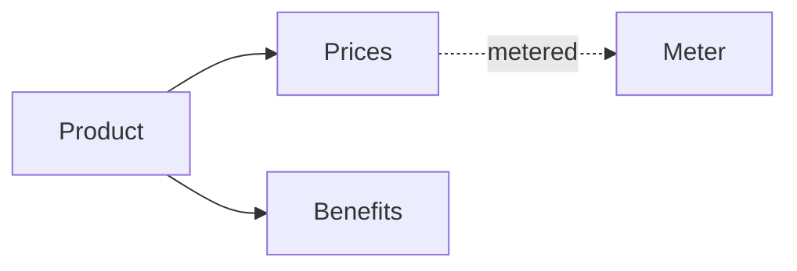

A **product** is anything you sell on Polar. Subscriptions and one-time purchases are both products: same API, same data model, different billing.

Each product has two parts:

- **Prices** decide what the customer pays.
- **[Benefits](/concepts/benefits)** decide what the customer gets.

## One-time or recurring

A product is either a **one-time purchase** or **recurring**.

- A one-time product is charged once and grants its benefits for good.
- A recurring product bills on an interval (daily, weekly, monthly or yearly, optionally every _n_ intervals). Buying it creates a [subscription](/concepts/orders-and-subscriptions).

The billing cycle is fixed when you create the product. To offer monthly and yearly plans, create two products and show both at checkout.

## Price types

| Type | The customer pays | Typical use |
| --- | --- | --- |
| `fixed` | A set amount, or nothing for a free product | Plans, licenses, free tiers |
| `custom` | An amount they choose, with an optional minimum | Pay what you want, donations |
| `seat_based` | Per seat, up front, with optional tiers | Team plans. See [Seat-based pricing](/features/seat-based-pricing) |
| `unit_based` | Per unit, up front, with optional tiers | Devices, capacity. See [Unit-based pricing](/features/unit-based-pricing) |
| `metered_unit` | A flat rate per unit of usage, after the period | API calls, tokens. See [Usage](/concepts/usage) |
| `metered_tiers` | Tiered rates for usage, after the period | Volume discounts on usage |

A product has one main price model. Metered prices stack on top: pair a fixed base fee with one or more metered prices for a "base + usage" plan.

## Prices over time

You can change the amount of a fixed price at any time. Existing subscribers keep the price they signed up at until you migrate them, so a change only affects new purchases.

Products can be priced in [several currencies](/features/products#multiple-payment-currencies). Polar picks one based on where the customer is, falling back to your organization's default currency.

Whether a price includes tax depends on your [tax behavior](/features/tax-inclusive-pricing) setting.

## Archiving

Archive a product to stop selling it. Existing customers keep their access and subscriptions keep renewing, but the product no longer appears in new checkouts. Only products that have never been used can be deleted permanently.

## Learn more

| Resource | Description |
| --- | --- |
| [Products](/features/products) | Create, configure and archive products |
| [Discounts](/features/discounts) | Percentage and fixed-amount discounts on products |
| [Products API](/api-reference/current/products/list-products) | Manage products programmatically |
