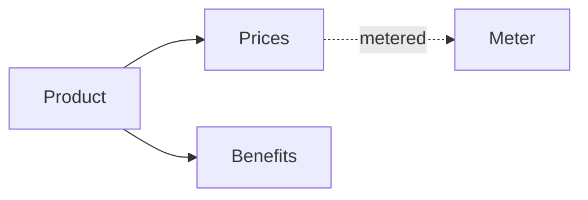

A **product** is anything you sell on Polar. Subscriptions and one-time purchases are both products: same API, same data model, different billing.

Each product has two parts:

- **Prices** decide what the customer pays.
- **[Benefits](/concepts/benefits)** decide what the customer gets.

## One-time or recurring

A product is either a **one-time purchase** or **recurring**. In the product form, these are **One-time purchase** and **Recurring subscription** under **Pricing**.

- A one-time product is charged once and grants its benefits for good.
- A recurring product bills on an interval (daily, weekly, monthly or yearly, optionally every _n_ intervals). Buying it creates a [subscription](/concepts/orders-and-subscriptions).

The billing cycle is fixed when you create the product. To offer monthly and yearly plans, create two products and show both at checkout.

## Price types

| API type | Dashboard | The customer pays | Typical use |
| --- | --- | --- | --- |
| `fixed` | **Fixed price**, or **Free** | A set amount, or nothing for a free product | Plans, licenses, free tiers |
| `custom` | **Pay what you want** | An amount they choose, with an optional minimum | Donations |
| `seat_based` | **Seats** | Per seat, up front, with optional tiers | Team plans. See [Seat-based pricing](/features/seat-based-pricing) |
| `unit_based` | **Units** | Per unit, up front, with optional tiers | Devices, capacity. See [Unit-based pricing](/features/unit-based-pricing) |
| `metered_unit` | **Metered price**, **Flat price per unit** | A flat rate per unit of usage, after the period | API calls, tokens. See [Usage](/concepts/usage) |
| `metered_tiers` | **Metered price**, **Graduated** or **Volume** | Tiered rates for usage, after the period | Volume discounts on usage |

A free price is a `fixed` price with `price_amount: 0`. There is no separate `free` type in the API, even though the dashboard lists **Free** as an option.

## Combining prices

A product can hold more than one price, within these rules:

- A `fixed` price and a `seat_based` price can be combined. The customer pays the fixed fee plus the seat charge.
- A `fixed` price and a `unit_based` price can be combined. `seat_based` and `unit_based` can't.
- A `custom` (pay what you want) price stands alone.
- A free price (`fixed` at 0) stands alone.
- Any number of metered prices can be added on top, one per meter. Pair a fixed base fee with metered prices for a "base + usage" plan.
- Metered prices aren't supported on one-time products.

Each of `fixed`, `custom`, `seat_based` and `unit_based` can appear at most once per currency.

## Choosing a quantity-based model

Three price types charge by quantity. They differ in what the quantity counts and when the customer pays.

| Model | The quantity counts | Customer pays | Benefits go to |
| --- | --- | --- | --- |
| Unit-based | Anything that isn't a person | Up front | The customer, once |
| Seat-based | People | Up front | Each member who claims a seat |
| Metered | Usage you record as events | After the period | The customer, once |

Pick seat-based when each unit maps to a person who needs their own access. Polar then handles invitations, seat claims and per-member benefits. Pick metered when Polar should count the quantity from usage events. Pick unit-based for everything else: the buyer declares the quantity at checkout.

## Prices over time

You can change the amount of a fixed price at any time. Existing subscribers keep the price they signed up at until you migrate them, so a change only affects new purchases.

Products can be priced in [several currencies](/features/products#multiple-payment-currencies). Polar picks one based on where the customer is, falling back to your organization's default currency.

Whether a price includes tax depends on your [tax behavior](/features/tax-inclusive-pricing) setting.

## Archiving

Archive a product to stop selling it. Existing customers keep their access and subscriptions keep renewing, but the product no longer appears in new checkouts. Only products that have never been used can be deleted permanently.

## In the dashboard, CLI or your agent

Products live under **Products** in the dashboard. The same tasks work from your terminal and your agent. See the [CLI reference](/integrate/cli/reference) and the [MCP server](/integrate/mcp).

| Task | Dashboard | CLI | MCP operation |
| --- | --- | --- | --- |
| Create a product | **Products → New Product** | `polar products create` | `products_create` |
| Attach benefits | **Automated Benefits** on the product | `polar products update_benefits <id>` | `products_update_benefits` |
| Archive or update a product | **Edit Product** or **Archive Product** in the product's menu | `polar products update <id>` | `products_update` |

## Learn more

| Resource | Description |
| --- | --- |
| [Products](/features/products) | Create, configure and archive products |
| [Discounts](/features/discounts) | Percentage and fixed-amount discounts on products |
| [Products API](/api-reference/current/products/list-products) | Manage products programmatically |
