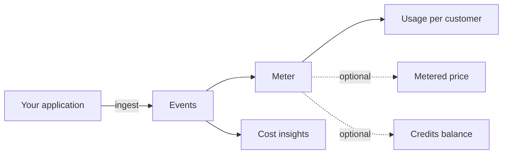

Polar tracks what each customer does in your product. Usage is built from two objects:

- **Events** are raw facts your application sends: "this customer made an API call", "this customer used 77 tokens".
- **Meters** filter and aggregate events into a usage number per customer.

Tracking usage doesn't require charging for it. You can send events and create meters with no metered price or credits at all, to see how customers use your product and what they cost you. Billing is one thing you can build on top, now or later.



## Events

An event has a `name`, the customer it belongs to (`external_customer_id` or `customer_id`), and a free-form `metadata` object:

```json
{
  "name": "ai_usage",
  "external_customer_id": "user_123",
  "metadata": {
    "model": "gpt-4.1-nano",
    "total_tokens": 77
  }
}
```

Send raw facts, not totals you've already computed. Polar does the counting, so the same events can feed several meters, and you can add a meter later without changing your code.

Events are immutable: once ingested, they can't be changed or deleted.

## Meters

A meter defines which events count and how to add them up:

- A **filter** selects events, for example `name` equals `ai_usage`.
- An **aggregation** turns them into a number: count, sum, average, minimum or maximum of a metadata property.

For example, a meter that filters on `ai_usage` and sums `total_tokens` gives you the tokens each customer used in a period.

## Tracking without billing

A meter on its own is a usage report. Read it per customer and per period from the dashboard, CLI or API. Common reasons to track usage you don't charge for:

- See which customers use a feature, and how much.
- Compare what each customer costs you, such as LLM tokens or storage, with what they pay. See [Costs](#costs).
- Collect real data before you decide on pricing. New meters backfill from events you've already sent, so you can explore pricing ideas against past usage.

## Charging for usage

When you do charge for usage, it reaches billing in two ways, and you can combine them.

**Metered prices** bill usage after the fact. Add a metered price to a recurring product, and Polar invoices the usage on the subscription's next order. See [Usage-based pricing](/features/usage-based-billing/billing).

**Credits** are prepaid. A [Meter Credits benefit](/features/usage-based-billing/credits) adds units to a customer's meter balance, once for a one-time purchase or every cycle for a subscription. Usage draws the balance down first. If the product also has a metered price, anything beyond the credits is billed as overage. Without one, usage is never charged.

The customer's current balance for each meter is part of their [customer state](/integrate/customer-state).

## Costs

Events can also carry what each action costs you, through a `_cost` metadata property. [Cost insights](/features/cost-insights/introduction) combines those costs with your revenue to show profit per customer. This works whether or not you bill for the usage behind them.

## In the dashboard, CLI or your agent

Events are sent from your application with the SDK or API. You can browse them under **Analytics → Events**. Everything else works from the dashboard, the CLI or your agent:

| Task | Dashboard | CLI | MCP operation |
| --- | --- | --- | --- |
| Create a meter | **Catalog → Meters → Create Meter** | `polar meters create` | `meters_create` |
| Read a meter's usage | Select the meter under **Catalog → Meters** | `polar meters quantities <id>` | `meters_quantities` |
| Read a customer's balance per meter | The customer's **Usage** tab | `polar customer_meters list` | `customer_meters_list` |
| List the event names you've sent | **Analytics → Events** | `polar events list_names` | `events_list_names` |

## Learn more

| Resource | Description |
| --- | --- |
| [Send events](/features/usage-based-billing/event-ingestion) | Send events with the SDK or API |
| [Ingestion strategies](/features/usage-based-billing/ingestion-strategies/ingestion-strategy) | Ready-made ingestion for LLMs, streams, S3 and more |
| [Meters](/features/usage-based-billing/meters) | Filters, aggregations and units |
| [Credits](/features/usage-based-billing/credits) | Prepaid usage and manual credit grants |
| [Cost insights](/features/cost-insights/introduction) | Costs and margins per customer |
| [Ingest Events API](/api-reference/current/events/ingest-events) | API reference |
