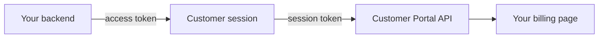

The hosted [Customer Portal](/features/customer-portal/introduction) can't be restyled. To give customers billing pages inside your own app, build them on the **Customer Portal API**: the same API the hosted portal uses, scoped to one signed-in customer.



Your backend creates a customer session with your access token. The session's token then calls the Customer Portal API on behalf of that one customer.

## Create a customer session

Create the session on your server, for the signed-in user:

<CodeGroup>
```typescript TypeScript
const session = await polar.customerSessions.create({
  external_customer_id: "user_123",
});

return { token: session.token };
```

```python Python
session = polar.customer_sessions.create(external_customer_id="user_123")

return {"token": session.token}
```

```bash cURL
export CUSTOMER_TOKEN=$(curl -s -X POST https://sandbox-api.polar.sh/v1/customer-sessions/ \
  -H "Authorization: Bearer $POLAR_ACCESS_TOKEN" \
  -H "Polar-Version: 2026-10" \
  -H "Content-Type: application/json" \
  -d '{ "external_customer_id": "user_123" }' | jq -r .token)
```
</CodeGroup>

- The `token` starts with `polar_mst_` and expires after one hour (`expires_at`). Create a new one when it runs out.
- For a [team customer](/concepts/customers#individuals-and-teams), pass `member_id` or `external_member_id` to act as a specific member. Without it, the session is for the customer's owner. What a member can do depends on their role.
- The token only grants access to that customer's data, so it's safe to use in the browser. Your access token never is.

<Note>Creating customer sessions is API only. Not available from the CLI or MCP server.</Note>

The examples use the sandbox and API version `2026-10`.

## Call the Customer Portal API

Use the session token as the bearer token. With the SDKs, create a second client with it:

<CodeGroup>
```typescript TypeScript
import { createPolar } from "@polar-sh/sdk/2026-10";

const portal = createPolar({ accessToken: token, environment: "sandbox" });

const subscriptions = await portal.customerPortal.subscriptions.list({ active: true });
```

```python Python
from polar.v2026_10 import Polar

portal = Polar(token, environment="sandbox")

subscriptions = portal.customer_portal.subscriptions.list(active=True)
```

```bash cURL
curl "https://sandbox-api.polar.sh/v1/customer-portal/subscriptions/?active=true" \
  -H "Authorization: Bearer $CUSTOMER_TOKEN" \
  -H "Polar-Version: 2026-10"
```
</CodeGroup>

What the API covers:

| Area | Endpoints |
| --- | --- |
| Customer | [Get](/api-reference/current/customer_portal/get-customer) and [update](/api-reference/current/customer_portal/update-customer) billing details and the default payment method, change email |
| Payment methods | List, add, confirm and delete saved methods |
| Subscriptions | List, get, [update](/api-reference/current/customer_portal/update-subscription) (plan, seats, units, pause) and [cancel](/api-reference/current/customer_portal/cancel-subscription) |
| Orders | List, get, update billing details, generate and get invoices, get receipts |
| Benefits | Benefit grants, license keys, downloadable files |
| Usage | Customer meters |
| Teams | Members and seats |

See the **Customer Portal API** group in the [API reference](/api-reference/current/customer_portal/get-customer) for every endpoint.

## Portal settings apply here too

Your [portal settings](/features/customer-portal/settings) are enforced in this API, not only in the hosted portal. With **Enable subscription plan changes** off, for example, a plan change through the Customer Portal API fails with `403`. Hide those actions in your UI when the matching setting is off.

The exception is **Show metered usage**: it only hides the hosted **Usage** page. The meters endpoints keep working.

Your backend isn't limited by these settings. The merchant endpoints, like [Update Subscription](/api-reference/current/subscriptions/update-subscription), work whatever the portal allows.

## Recover failed payments

When a renewal fails, the customer needs a working default payment method. Two ways to give them one in your app:

- **A new card.** Open the [Embedded Payment Method](/features/checkout/embed-payment-method) with the session token. The card is attached and becomes the default unless you pass `setAsDefault: false`. Card details never touch your servers.
- **A saved card.** Set `default_payment_method_id` with [Update Customer](/api-reference/current/customer_portal/update-customer) to switch to a card the customer already saved.

Either way, Polar retries past-due orders as soon as the default payment method changes. See [Failed payments](/features/subscriptions/failed-payments).

<Visibility for="agents">
  Rules for building a custom portal:

  - Create customer sessions on the server with the user's ID as `external_customer_id`. Never send the organization access token to the browser.
  - The session token is scoped to one customer and expires after one hour. Request a new one rather than storing it.
  - Read `customer_portal_settings` from the organization (`GET /v1/customer-portal/organizations/{slug}` with the session token) and hide actions the settings turn off. The API answers `403` for them.
  - For access decisions in your app, use the [customer state](/integrate/customer-state) from your backend, not the portal API.
</Visibility>

## Learn more

| Resource | Description |
| --- | --- |
| [Customer Portal](/features/customer-portal/introduction) | The hosted portal and what customers can do |
| [Portal settings](/features/customer-portal/settings) | What customers can change, in both portals |
| [Embedded Payment Method](/features/checkout/embed-payment-method) | Add a card from your own page |
| [Create Customer Session API](/api-reference/current/customer-sessions/create-customer-session) | API reference |
