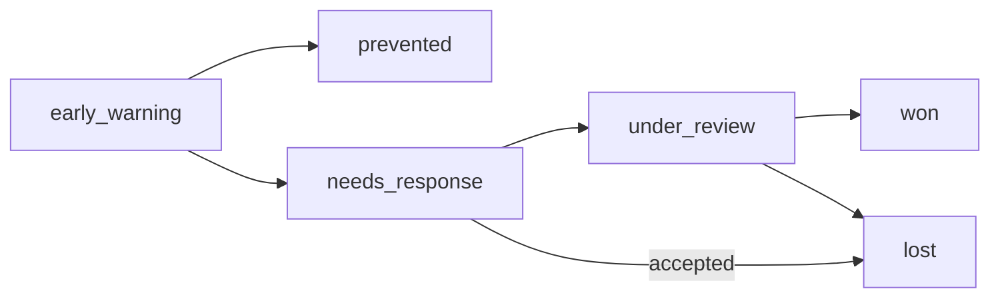

A **dispute**, or chargeback, is when a customer asks their bank to reverse a payment. The bank pulls the money back while the card network decides who's right. As your [Merchant of Record](/merchant-of-record/introduction), Polar is the seller on record, receives the dispute and settles it with the processor.

You can either **accept** a dispute, conceding it, or **counter** it with evidence that the payment was valid.

The code examples use API version `2026-10` and the sandbox.

## Statuses

| Dashboard | API `status` | Meaning |
| --- | --- | --- |
| **Early Warning** | `early_warning` | A card network warned that a dispute may follow. No dispute has been filed yet |
| **Prevented** | `prevented` | Polar refunded the customer before the dispute escalated, so no dispute fee applies |
| **Needs Response** | `needs_response` | The dispute is open. You can accept or counter it until `evidence_due_by` |
| **Under Review** | `under_review` | Evidence was submitted and the card network is deciding |
| **Won** | `won` | The network ruled in your favor |
| **Lost** | `lost` | The network ruled for the customer, or the dispute was accepted |

`resolved` is `true` for `won` and `lost`. `closed` is `true` for `prevented`, `won` and `lost`. A dispute also carries `amount` and `tax_amount` in cents, the `reason` reported by the network (such as `fraudulent` or `product_not_received`, shown as **Fraudulent** and **Product not received** in the dashboard), `evidence_due_by`, `past_due`, and the `order_id` and `payment_id` it belongs to.



## What a dispute costs

When a dispute is resolved, the disputed amount and the processor's dispute fee are deducted from your balance. If you win, the disputed amount is returned. See [Fees](/merchant-of-record/fees).

When a dispute closes as `prevented`, `won` or `lost`, Polar ends the related subscription immediately and revokes the order's benefits, including any seats.

While a payment is disputed, you can't [refund](/features/refunds) the order. Accept or counter the dispute instead.

Polar watches for early warnings from the card networks and refunds some lower-value orders before a dispute is filed. Those refunds use the reason `dispute_prevention` and the dispute shows as `prevented`.

## Find and respond in the dashboard

<Note>
  The disputes dashboard is in preview. Access is granted per organization. Contact [support](/support) to request it.
</Note>

Without access, a disputed order still lists its disputes in the **Disputes** section of its page under **Sales → Orders**.

With access, disputes appear under **Sales → Disputes**. Filter them by status. Each dispute shows the amount, the network's reason, a **Respond by** deadline and the related order and customer.

- Click **Accept dispute** to concede it.
- Click **Counter dispute** to contest it. Pick why you should win (**The cardholder withdrew the dispute**, **The cardholder was refunded**, **The purchase was made by the rightful cardholder** or **Other**), explain why the payment is legitimate in at least 20 characters, and upload supporting evidence such as messages with the customer.

Polar submits your evidence to the card network and the dispute moves to **Under Review** (`under_review`). The dispute page keeps a timeline and a support chat with Polar.

### Accept small disputes automatically

<Note>
  Auto-accept is in preview. Access is granted per organization. Contact [support](/support) to request it.
</Note>

Under **Settings → Disputes**, turn on **Accept small disputes** and set **Up to**, in whole dollars up to $100. Polar accepts disputes below that amount for you one day after they open, unless you reply first. Disputes in other currencies are converted. The disputed amount and the processor's dispute fee are still deducted.

## List and get disputes over the API

<Note>
  API only. Not available from the CLI or MCP server.
</Note>

<CodeGroup>
```typescript TypeScript
const disputes = await polar.disputes.list({ status: "needs_response" });

for (const dispute of disputes.items) {
  console.log(dispute.id, dispute.amount, dispute.evidence_due_by);
}
```

```python Python
disputes = polar.disputes.list(status="needs_response")

for dispute in disputes.items:
    print(dispute.id, dispute.amount, dispute.evidence_due_by)
```

```bash cURL
curl -G https://sandbox-api.polar.sh/v1/disputes/ \
  -H "Authorization: Bearer $POLAR_ACCESS_TOKEN" \
  -H "Polar-Version: 2026-10" \
  --data-urlencode "status=needs_response"
```
</CodeGroup>

Filter by `order_id` to find the dispute on a given order. Fetch one with `polar.disputes.get(id)` or `GET /v1/disputes/{id}`. Reading disputes needs the `disputes:read` scope.

## Accept a dispute

Accepting concedes the chargeback. Polar closes the dispute with the processor, which settles it as `lost`. The customer keeps the refund, and the amount and dispute fee are deducted from your balance. Only a dispute in `needs_response` can be accepted. Otherwise the API returns `409`.

<CodeGroup>
```typescript TypeScript
const dispute = await polar.disputes.accept(disputeId);
```

```python Python
dispute = polar.disputes.accept(dispute_id)
```

```bash cURL
curl -X POST "https://sandbox-api.polar.sh/v1/disputes/$DISPUTE_ID/accept" \
  -H "Authorization: Bearer $POLAR_ACCESS_TOKEN" \
  -H "Polar-Version: 2026-10"
```
</CodeGroup>

Accepting needs the `disputes:write` scope.

<Visibility for="agents">
  Accepting a dispute is irreversible and costs the merchant the disputed amount plus the dispute fee. Confirm with the user before calling `POST /v1/disputes/{id}/accept`. There is no CLI command or MCP operation for disputes, and no dispute webhooks.
</Visibility>

## Learn more

| Resource | Description |
| --- | --- |
| [Refunds](/features/refunds) | Refund an order before it turns into a dispute |
| [Fees](/merchant-of-record/fees) | Dispute fees and other charges |
| [Account reviews](/merchant-of-record/account-reviews) | Why a low dispute rate matters for your account |
| [Disputes API](/api-reference/current/disputes/list-disputes) | List, get and accept disputes |
