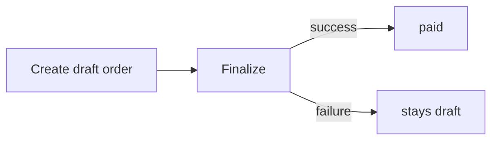

An **off-session charge** bills a customer's saved payment method while they're not present: a usage overage, a professional-services fee or a manual top-up. It's a two-step flow. You create a **draft order**, then **finalize** it to attempt the charge.

<Note>
  Off-session charges are in preview. Access is granted per organization. Contact [support](/support) to request it.
</Note>

<Note>
  API only. Not available from the CLI or MCP server.
</Note>

The code examples use API version `2026-10` and the sandbox. Both requests need the `orders:write` scope.



## Before you start

The customer needs:

- A complete billing address, so Polar can calculate tax.
- At least one saved payment method, for example from an earlier checkout or added in the [Customer Portal](/features/customer-portal/introduction).

You also need a one-time product to charge for. Only fixed-price, free and unit-based products are supported.

## 1. Create a draft order

`POST /v1/orders/` creates an order with `status: "draft"` and no invoice number. Nothing is charged yet.

| Field | Required | Description |
| --- | --- | --- |
| `customer_id` | Yes | The customer to charge |
| `product_id` | Yes | A one-time fixed-price, free or unit-based product |
| `amount` | No | A custom amount in the smallest currency unit, such as `2500` for $25.00. Defaults to the product's price. Can't be combined with `units` |
| `units` | No | The quantity to charge for. Required for unit-based products and rejected for others. The amount comes from the price's tiers |
| `currency` | No | Lowercase ISO 4217, such as `usd`. Defaults to the organization's default currency |
| `description` | No | The line item text on the invoice and receipt. Defaults to the product name |
| `metadata` | No | Your own key-value data |

<CodeGroup>
```typescript TypeScript
const order = await polar.orders.create({
  customer_id: customerId,
  product_id: productId,
  amount: 2500,
  description: "5,000 extra tokens",
});
```

```python Python
order = polar.orders.create(
    customer_id=customer_id,
    product_id=product_id,
    amount=2500,
    description="5,000 extra tokens",
)
```

```bash cURL
export ORDER_ID=$(curl -s -X POST https://sandbox-api.polar.sh/v1/orders/ \
  -H "Authorization: Bearer $POLAR_ACCESS_TOKEN" \
  -H "Polar-Version: 2026-10" \
  -H "Content-Type: application/json" \
  -d '{
    "customer_id": "'"$CUSTOMER_ID"'",
    "product_id": "'"$PRODUCT_ID"'",
    "amount": 2500,
    "description": "5,000 extra tokens"
  }' | jq -r .id)
```
</CodeGroup>

Creating a draft sends the `order.created` webhook. The customer isn't emailed yet.

## 2. Finalize and charge

`POST /v1/orders/{id}/finalize` attempts the charge and waits for the result. It uses the customer's default payment method, or the one you pass as `payment_method_id`.

<CodeGroup>
```typescript TypeScript
const paid = await polar.orders.finalize(order.id, {});
```

```python Python
paid = polar.orders.finalize(order.id)
```

```bash cURL
curl -X POST "https://sandbox-api.polar.sh/v1/orders/$ORDER_ID/finalize" \
  -H "Authorization: Bearer $POLAR_ACCESS_TOKEN" \
  -H "Polar-Version: 2026-10" \
  -H "Content-Type: application/json" \
  -d '{}'
```
</CodeGroup>

On success, the order becomes `paid` and gets an invoice number. Polar grants the product's [benefits](/concepts/benefits) before the response returns, emails the customer a confirmation and sends `order.paid`.

In the dashboard, the order shows under **Sales → Orders** as **Draft** until it's finalized, then as **Paid**. Open it to see the **Payment attempts** for each try.

## Handle failures

If the charge fails, the API returns an error and the order stays `draft`. Fix the problem and finalize the same order again. A failed attempt doesn't use up an invoice number.

| Status | When |
| --- | --- |
| `402` | The card was declined, the customer has no payment method, or the charge needs a 3D Secure challenge that can't be completed off-session |
| `403` | Off-session charges aren't enabled for the organization, or it can't accept payments right now |
| `412` | The order isn't a draft anymore, for example because it was already finalized |

### Customer authentication

When a charge needs the customer to authenticate, for example with a 3D Secure challenge, the `402` error is `PaymentActionRequired`. From API version `2027-01`, the order has a `payment_url`. Send the customer there to authenticate and pay the order in the [Customer Portal](/features/customer-portal/introduction).

Customers who aren't signed in to the portal confirm their email first. Once the customer pays, Polar grants the benefits and sends `order.paid`, as with a successful finalize.

On earlier API versions, ask the customer to pay through a [Checkout Session](/features/checkout/session) instead.

<Visibility for="agents">
  Off-session charges need preview access; a 403 on finalize means it isn't enabled. Never retry a 402 in a loop. A draft order can be finalized again after the cause is fixed. There is no CLI command or MCP operation for creating or finalizing orders.
</Visibility>

## Learn more

| Resource | Description |
| --- | --- |
| [Orders](/features/orders) | Invoices, receipts and payment attempts |
| [Orders & subscriptions](/concepts/orders-and-subscriptions) | Order statuses, including `draft` |
| [Create Order API](/api-reference/current/orders/create-order) | Create a draft order |
| [Finalize Order API](/api-reference/current/orders/finalize-order) | Charge a draft order |
