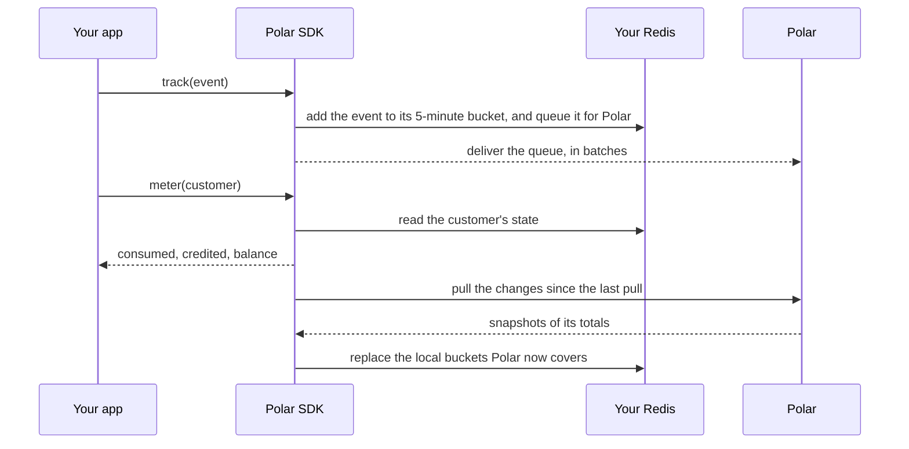

Outpost runs inside the Polar SDK. It keeps a copy of each customer's meter usage in a Redis you own, updates that copy when you track an event, and answers balance reads from it. It also delivers your events to Polar. Polar stays the source of truth: it sends its totals back, and they replace the local copy.

Use it when your application has to check a balance on every request, and a round trip to Polar on each one is too slow. A read answers in about 1.5 ms, and under 20 ms at p99 up to 10,000 events/s on one Redis: see [Performance and sizing](#performance-and-sizing).

## What it promises

- A read sees every event `track()` has returned for, on every instance that shares the Redis.
- A read is a few Redis commands. It never calls Polar once the customer is known.
- An event counts locally until Polar has stored it. Polar's totals then replace the local count, bucket by bucket. A local balance is never higher than Polar's.
- A credit reaches local reads at the next pull, within 30 seconds of the grant.

## What it leaves to you

- Outpost never refuses an event. Checking the balance before you serve a request is your call, as it is without Outpost.
- Polar's own meter reads lag behind Outpost by the time it takes to deliver and ingest the events. Both converge within minutes.

## How it works



Every instance of your application that runs the SDK with the same Redis shares one state and one queue. A read goes to Redis, so it sees the writes of every other instance at once. One instance at a time pulls Polar's changes for the whole fleet.

## Set it up

<Steps>
  <Step title="Give Outpost a Redis database">
    Outpost needs a Redis reachable from every instance of your application. Give it a database of its own, and one per environment: a sandbox and a production deployment must not share one.
  </Step>
  <Step title="Use an organization access token with events:write">
    Outpost calls Polar with the token your client uses. The token needs the `events:write` scope, the same one event ingestion needs.
  </Step>
  <Step title="Start Metering with Outpost">
    Outpost is off by default. With Outpost, `Metering` sends your events through Outpost instead of its in-memory buffer: pass the buffer's options or Outpost's, not both.
  </Step>
</Steps>

<Tabs>
  <Tab title="TypeScript">
    Outpost needs the optional `ioredis` and `@opentelemetry/*` peer dependencies; the rest of the SDK does not.

    ```typescript
    import { createPolar } from "@polar-sh/sdk/2026-10";
    import { outpost } from "@polar-sh/sdk/outpost";

    const polar = createPolar({ accessToken: process.env.POLAR_ACCESS_TOKEN! });

    const metering = polar.metering({ outpost: outpost() });
    ```

    `outpost()` reads `REDIS_URL` and throws if it is unset. Pass options to configure it:

    | Option            | Default                          | Meaning                                                          |
    | ----------------- | -------------------------------- | ---------------------------------------------------------------- |
    | `redisUrl`        | `REDIS_URL` environment variable | The Redis Outpost uses.                                          |
    | `telemetry`       | `true`                           | Send Outpost metrics and traces to Polar.                        |
    | `snapshotTimeout` | `5000`                           | Milliseconds the first read of a customer waits for Polar's snapshot before it throws. |
    | `onDelivered`     | `undefined`                      | Called with each batch Polar accepted; may be async.             |
    | `onDropped`       | `undefined`                      | Called with the events Polar refused, and why; may be async.     |
  </Tab>
  <Tab title="Python">
    Outpost needs the `outpost` extra: `pip install "polar-sdk[outpost]"`.

    ```python
    import os

    from polar.v2026_10 import PolarAsync

    async with PolarAsync(os.environ["POLAR_ACCESS_TOKEN"]) as polar:
        async with polar.metering(outpost=True) as metering:
            ...
    ```

    `outpost=True` reads `REDIS_URL` and raises if it is unset. Pass a dictionary instead to configure it:

    | Option             | Default                          | Meaning                                                                           |
    | ------------------ | -------------------------------- | --------------------------------------------------------------------------------- |
    | `redis_url`        | `REDIS_URL` environment variable | The Redis Outpost uses.                                                           |
    | `telemetry`        | `True`                           | Send Outpost metrics and traces to Polar.                                         |
    | `snapshot_timeout` | `5`                              | Seconds the first read of a customer waits for Polar's snapshot before it raises. |
    | `on_delivered`     | `None`                           | Async function called with each batch Polar accepted.                             |
    | `on_dropped`       | `None`                           | Async function called with the events Polar refused, and why.                     |
  </Tab>
</Tabs>

## Track and read

Every event needs an `external_id`. Outpost uses it to count an event once while Polar has not confirmed it, and Polar uses it to bill the event once. `track()` rejects an event without one. An event tracked again after Polar confirmed it counts locally a second time, until Polar's totals replace its bucket a few minutes later.

In Python, `track()` also rejects a NaN or an infinity anywhere in the event.

The first read of a customer waits for Polar's snapshot, up to `snapshotTimeout` (5 seconds by default). If it does not arrive in time, `meter()` throws `NotReadyError`, and the next read asks Polar again. Import the error from `@polar-sh/sdk/outpost` or `polar.outpost`. Warm the customer when the session starts, so the read that matters is ready:

<Tabs>
  <Tab title="TypeScript">
    ```typescript
    const actor = await metering.actor({ external_customer_id: "customer_123" });
    await actor.track({ name: "api_request", external_id: "req_42", metadata: { tokens: 42 } });

    const meter = await actor.meter("meter_uuid");
    if (meter !== null && meter.balance <= 0) {
      // Decline the call, switch to a cheaper model, or ask for a top-up.
    }
    ```
  </Tab>
  <Tab title="Python">
    ```python
    actor = await metering.actor(external_customer_id="customer_123")
    await actor.track(name="api_request", external_id="req_42", metadata={"tokens": 42})

    meter = await actor.meter("meter_uuid")
    if meter is not None and meter.balance <= 0:
        ...  # Decline the call, switch to a cheaper model, or ask for a top-up.
    ```
  </Tab>
</Tabs>

A read returns the customer's `consumed_units`, `credited_units` and `balance` for one meter, computed as Polar does: credits minus consumption.

## Deliver the events

Outpost queues each event in Redis when you track it, and delivers the queue to Polar in batches of up to 1,000 events, shared by every instance. A long-running server delivers every second on its own. In a serverless runtime, flush `Metering` after each response, as the [SDK guide](/integrate/sdk/typescript) explains, so the function does not freeze before the delivery starts.

With Outpost, `flush()` does not fail when a delivery does: the events stay queued, and the next flush takes them. It can still time out.

`onDelivered` and `onDropped` run on the instance that delivered the batch. A batch mixes events from every instance, so it does not map to one request.

## Performance and sizing

Our measurements show, with 1,000 customers and one event per request on Vercel:

| Load            | SDK        | Read p50 | p95    | p99   |
| --------------- | ---------- | -------- | ------ | ----- |
| 2,000 events/s  | TypeScript | 1.4 ms   | 2.3 ms | 8 ms  |
| 2,000 events/s  | Python     | 1.5 ms   | 2.7 ms | 9 ms  |
| 10,000 events/s | TypeScript | 1.5 ms   | 9 ms   | 15 ms |
| 10,000 events/s | Python     | 1.7 ms   | 11 ms  | 16 ms |

These numbers come from one Redis Cloud database on the 2.5 GB plan, running Redis 8. Latency follows how busy Redis is, because one Redis core runs every command: at 10,000 events/s it is busy about half the time. Past that the slowest reads grow fast, and near 16,000 events/s one Redis no longer keeps up. If you need more, [contact support](/support).

## When something is down

**Redis is unreachable.** `track()` and `meter()` fail with `UnavailableRedisError`, and the event is not queued for Polar. Your code decides whether to serve the request without a balance, and whether to track the event again. Outpost reconnects on its own.

**Polar is unreachable or overloaded.** Reads keep answering, with the last totals Polar sent plus every event tracked since. Events stay queued in Redis. After a failed delivery, every instance waits before it tries again: as long as Polar asks with `Retry-After`, otherwise 1 second, doubling up to a minute. A first read of a customer Outpost has never seen fails with `NotReadyError` once `snapshotTimeout` passes, because no snapshot can arrive.

**Polar refuses events.** A `4xx` other than `401`, `403` or `429` means a retry cannot succeed. When Polar names the events it refuses, Outpost drops those, reports them to `onDropped`, and sends the rest of the batch again. Otherwise it drops the whole batch. Polar never bills a dropped event; it leaves local reads once Polar's totals replace its bucket, a few minutes later. Polar accepts a timestamp up to 5 seconds ahead of its clock.

**Polar refuses the token.** On a `401` or a `403`, Outpost keeps the events queued and tries again. `track()` and `meter()` fail with `PolarOutpostError` until a pull succeeds; Outpost tries one every 30 seconds.

**The queue holds an entry Outpost cannot read.** Outpost drops it with a warning in your logs and delivers the rest.

**An instance restarts.** Nothing to rebuild: the state and the queue live in Redis. A new instance reads them, and asks Polar for a snapshot of each customer it touches for the first time.

## Telemetry

Outpost sends Polar the latency of local writes and reads, their outcomes, connection events, and the difference between local and Polar totals at each snapshot. Polar uses it to improve Outpost and to see how it runs in your deployment. It holds numbers, reducer IDs and customer identities, never your events' metadata. Each instance queues its exports in Redis, and the instance that pulls sends them to Polar, over the same token.

To turn it off, pass `telemetry: false`, or set `POLAR_OUTPOST_TELEMETRY=0`.

## What Outpost stores in Redis

Every key starts with `outpost:v1:` and your organization ID, which the table leaves out. One key is the exception: `outpost:v1:configuration:<hash>` holds your meters' configuration under a hash of the access token, with no expiry.

| Key                               | Content                                                                            | Lifetime                                         |
| --------------------------------- | ---------------------------------------------------------------------------------- | ------------------------------------------------ |
| `state:<customer>:<reducer>`      | One hash per customer and meter: Polar's totals and the local 5-minute buckets    | 24 hours after the last read, write or snapshot  |
| `pending:<customer>:<reducer>:<bucket>` | The events of a bucket Polar has not confirmed yet                          | 65 minutes after the last write                  |
| `outbox`                          | A stream of the events waiting for delivery to Polar                               | Until Polar takes them                           |
| `pull`, `configuration`           | The position in Polar's changes, and your meters' configuration                    | No expiry                                        |
| `telemetry:<kind>`                | Telemetry exports waiting to be sent                                               | The newest 1,000 exports                         |

Locks, queues and backoffs (`pull:lock`, `cold`, `fetch:…`, `missing:…`, `outbox:flusher:<slot>`, `outbox:backoff`) coordinate the instances. They expire within a minute, or once their work is done.

A customer who stops sending events disappears from Redis after a day. A hash holds a few hundred bytes per bucket, and Polar's snapshots fold buckets into one total every five minutes, so a customer costs a few kilobytes. The outbox holds each event until Polar takes it, usually within a second.

The `v1` in each key names the layout. A future layout takes a new version and starts from Polar's snapshot; it never reads the previous keys, which expire on their own.
