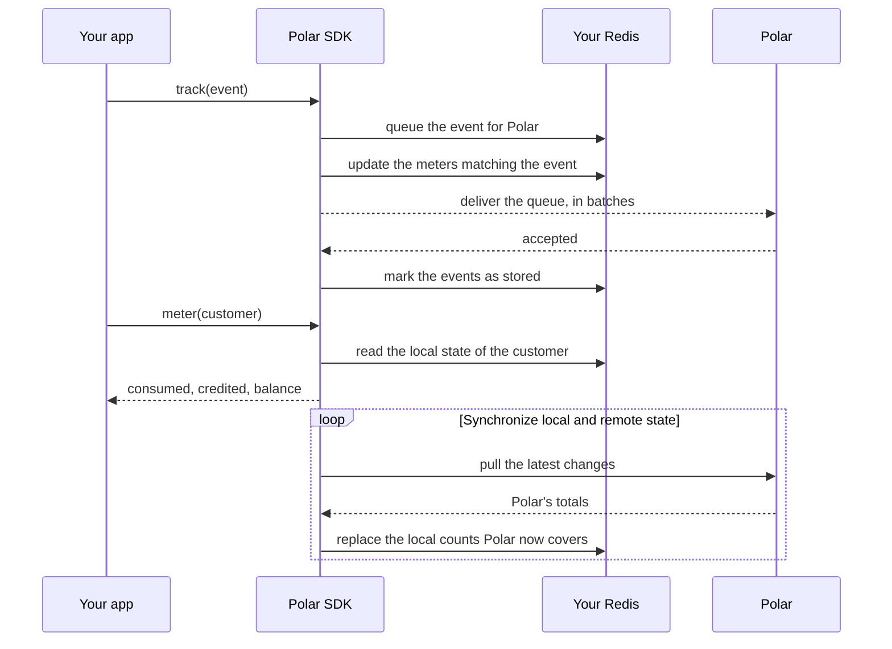

Outpost is the Polar SDK's zero-latency metering. It gives you two things:

- Balance checks in the hot path of every request.
- Event delivery that rides out network issues between you and Polar.

Outpost keeps a copy of each customer's meter usage in a Redis database you own. It updates that copy when you track an event, and answers balance reads from it. A Redis event queue in the same database batches your events and retries their delivery to Polar.

Polar stays the source of truth. When its totals change, Outpost pulls them and replaces the local copy, so the two converge.

Use Outpost when you check a balance on every request, and a round trip to Polar on each check is too slow. In our load test at 10,000 events/s, a read took 1.7 ms at the median: see [Performance and sizing](#performance-and-sizing).

## How it works

### What to expect

- A read sees every event tracked on any instance that shares the Redis, as soon as `track()` returns.
- Once Outpost knows a customer, reads stay in your Redis. They don't call Polar.
- Outpost counts an event locally until Polar has stored it, so your local balance is never higher than Polar's.
- A credit granted in Polar reaches local reads within 30 seconds.
- Outpost reports the balance. Your code decides whether to serve the request, as it does without Outpost.
- Polar's own meter reads catch up with Outpost within minutes, once the events are delivered and ingested.

### The flow



Every instance of your application that runs the SDK with the same Redis shares state and queued events. A read goes to Redis, so it sees the writes of every other instance at once. One instance at a time pulls Polar's changes for the whole fleet.

## Configuration

### Prepare Redis

Outpost needs a Redis reachable from every instance of your application. Give it a database of its own, and one per environment: a sandbox and a production deployment must not share one.

The queue holds your events until Polar takes them, so configure Redis to keep them:

- **Turn on AOF persistence** (`appendonly yes`). With snapshots (RDB) alone, a Redis restart loses the events queued since the last snapshot. With AOF and `appendfsync everysec`, it loses at most a second of writes. See Redis's [persistence guide](https://redis.io/docs/latest/operate/oss_and_stack/management/persistence/).
- **Set `maxmemory-policy` to `noeviction`.** An evicting policy can drop queued events. With `noeviction`, a full Redis refuses new writes, and `track()` fails where you can see it.

### Use an access token with events:write

Outpost and the queue call Polar with the token your client uses: an organization access token with the `events:write` scope, the same one event ingestion needs.

### Use RedisEventQueue

<Warning>
  Use `RedisEventQueue` with Outpost, on every runtime. `metering()` defaults to `MemoryEventQueue`, and the SDK does not stop you from using it with Outpost, but it can lose events Outpost already counted.
</Warning>

An event Outpost has counted must survive until Polar has it. `MemoryEventQueue` holds events in the process: if the process dies, or a serverless function freezes before its next flush, the events are gone. Outpost has counted them, and Polar never will. `RedisEventQueue` keeps each event in Redis until Polar takes it.

It also delivers better. Every instance shares one stream, so the queue batches events across the fleet, and when Polar is busy the whole fleet backs off together.

Outpost already needs Redis, so the queue costs nothing extra: pass both the same Redis URL and they share one client.

### Start Metering

Outpost is off by default. Pass the queue and Outpost to `metering()`.

<Tabs>
  <Tab title="TypeScript">
    Outpost and `RedisEventQueue` need the optional `ioredis` and `@opentelemetry/*` peer dependencies; the rest of the SDK does not.

    ```typescript
    import { createPolar } from "@polar-sh/sdk/2026-10";
    import { RedisEventQueue } from "@polar-sh/sdk/metering/queue/redis";
    import { outpost } from "@polar-sh/sdk/outpost";

    const redisUrl = process.env.REDIS_URL!;
    const polar = createPolar({ accessToken: process.env.POLAR_ACCESS_TOKEN! });

    const metering = polar.metering({
      queue: new RedisEventQueue(redisUrl, { stream: "polar:events" }),
      outpost: outpost({ redis: redisUrl }),
    });
    ```

    `metering()` takes:

    | Option       | Default                  | Meaning                                                                   |
    | ------------ | ------------------------ | ------------------------------------------------------------------------- |
    | `queue`      | `new MemoryEventQueue()` | The queue that delivers events to Polar. Outpost needs `RedisEventQueue`. |
    | `outpost`    | `undefined`              | Outpost, from `outpost()`. Without it, reads call Polar's API.            |
    | `onAck`      | `undefined`              | Called with each batch Polar accepted; may be async.                      |
    | `onRejected` | `undefined`              | Called with the events Polar refused, and why; may be async.              |

    `outpost()` throws if neither `redis` nor `REDIS_URL` is set. It takes:

    | Option            | Default                          | Meaning                                                               |
    | ----------------- | -------------------------------- | --------------------------------------------------------------------- |
    | `redis`           | `REDIS_URL` environment variable | A Redis URL, or an `ioredis` client you own.                          |
    | `telemetry`       | `true`                           | Send Outpost metrics and traces to Polar.                             |
    | `snapshotTimeout` | `5000`                           | Milliseconds the first read of a customer waits for Polar's totals.   |

    `new RedisEventQueue(redis, { stream })` takes a Redis URL or an `ioredis` client you own, and the stream's key. Use one stream per Polar environment and organization.
  </Tab>
  <Tab title="Python">
    Outpost and `RedisEventQueue` need the `outpost` extra: `pip install "polar-sdk[outpost]"`.

    ```python
    import os

    from polar.metering.queue.redis import RedisEventQueue
    from polar.v2026_10 import PolarAsync

    redis_url = os.environ["REDIS_URL"]

    async with PolarAsync(os.environ["POLAR_ACCESS_TOKEN"]) as polar:
        async with polar.metering(
            queue=RedisEventQueue(redis_url, stream="polar:events"),
            outpost={"redis": redis_url},
        ) as metering:
            ...
    ```

    `metering()` takes:

    | Option        | Default              | Meaning                                                                                    |
    | ------------- | -------------------- | ------------------------------------------------------------------------------------------ |
    | `queue`       | `MemoryEventQueue()` | The queue that delivers events to Polar. Outpost needs `RedisEventQueue`.                  |
    | `outpost`     | `None`               | `True` to use `REDIS_URL`, or a dictionary of options. Without it, reads call Polar's API. |
    | `on_ack`      | `None`               | Async function called with each batch Polar accepted.                                      |
    | `on_rejected` | `None`               | Async function called with the events Polar refused, and why.                              |

    `outpost` raises if neither `redis` nor `REDIS_URL` is set. Its dictionary takes:

    | Option             | Default                          | Meaning                                                            |
    | ------------------ | -------------------------------- | ------------------------------------------------------------------ |
    | `redis`            | `REDIS_URL` environment variable | A Redis URL, or an asynchronous `redis` client you own.            |
    | `telemetry`        | `True`                           | Send Outpost metrics and traces to Polar.                          |
    | `snapshot_timeout` | `5`                              | Seconds the first read of a customer waits for Polar's totals.     |

    `RedisEventQueue(redis, stream=...)` takes a Redis URL or an asynchronous `redis` client you own, and the stream's key. Use one stream per Polar environment and organization.
  </Tab>
</Tabs>

The queue and Outpost share a connection only when you pass both the same URL string. Pass two clients you own, or two different URLs, and each keeps its own.

Without Outpost, `metering()` uses `MemoryEventQueue` by default. It takes `batchSize`, `batchIntervalMs` and `maxAttempts` in TypeScript, or `batch_size`, `batch_interval`, `shutdown_timeout` and `max_attempts` in Python.

### Track and read

Outpost counts each event once per `external_id` while Polar has not confirmed it. `track()` gives an event without an `external_id` a random one, and dates an event without a `timestamp`. Set your own `external_id` when you might track the same event twice, such as on a retried request.

<Note>
  Polar discards an event it already has with the same `external_id`, but an event tracked again after Polar confirmed it counts again locally. Outpost corrects this the next time it reconciles with Polar, a few minutes later at most.
</Note>

In Python, `RedisEventQueue` rejects a NaN or an infinity anywhere in the event, and `track()` raises.

The first read of a customer waits for Polar's totals, up to `snapshotTimeout` (5 seconds by default). `meter()` reads Polar's API instead when Outpost can't answer: the totals haven't arrived, Redis is unreachable, or Outpost doesn't know the meter. That read takes a round trip to Polar.

Call `actor()` when a session, a conversation or an agent run starts. It waits for Polar's totals the same way, so the reads that decide whether to serve find the customer ready.

<Tabs>
  <Tab title="TypeScript">
    ```typescript
    // When the session starts
    const actor = await metering.actor({ external_customer_id: "customer_123" });

    // On each request of the session
    const meter = await actor.meter("meter_uuid");
    if (meter !== null && meter.balance <= 0) {
      // Decline the call, switch to a cheaper model, or ask for a top-up.
    }
    await actor.track({ name: "api_request", external_id: "req_42", metadata: { tokens: 42 } });
    ```
  </Tab>
  <Tab title="Python">
    ```python
    # When the session starts
    actor = await metering.actor(external_customer_id="customer_123")

    # On each request of the session
    meter = await actor.meter("meter_uuid")
    if meter is not None and meter.balance <= 0:
        ...  # Decline the call, switch to a cheaper model, or ask for a top-up.
    await actor.track(name="api_request", external_id="req_42", metadata={"tokens": 42})
    ```
  </Tab>
</Tabs>

A read returns the customer's `consumed_units`, `credited_units` and `balance` for one meter, computed as Polar does: credits minus consumption.

### Flush

A long-running server delivers on its own, every second. A serverless function freezes once it answers, so flush `Metering` after each response:

<Tabs>
  <Tab title="TypeScript">
    On Next.js, flush in `after()`: the function stays alive until the flush ends, and the response does not wait for it.

    ```typescript
    import { after } from "next/server";

    after(() => metering.flush());
    ```
  </Tab>
  <Tab title="Python">
    Flush before you return the response.

    ```python
    await metering.flush()
    ```
  </Tab>
</Tabs>

`flush()` delivers this instance's events, or waits for this instance's delivery in flight. It never waits for the rest of the fleet's queue. When flushes overlap, a newer one releases each older one that would end before it: one waiter keeps the function alive until the delivery ends, the others return.

`flush()` does not fail when a delivery does: the events stay queued, and the next flush takes them. It can still time out.

### Delivery callbacks

`onAck` and `onRejected` run on the instance that delivered the batch. A batch mixes events from every instance, so it does not map to one request, and a callback can run twice for the same events if an instance stops before it acknowledges them. Keep them short: the instance waits for them before it delivers its next batch, and `flush()` and `close()` wait for them too. An error a callback throws goes to your logs and stops nothing.

`onRejected` receives the reason `permanent_error`: Polar refused the events, and a retry cannot succeed. The queue keeps every other event until Polar takes it.

## Performance and sizing

A local read took 1.7 ms at the median at 10,000 events per second:

| Local read (`meter()`) | Latency |
| ---------------------- | ------- |
| Median                 | 1.7 ms  |
| p95                    | 14 ms   |
| p99                    | 25 ms   |

Measured on Polar's test environment on 2026-11-27, not a guarantee: the TypeScript SDK on Vercel with `RedisEventQueue` and Outpost, 1,000 customers, one event per request, 10,000 events per second for 6.5 minutes. Every balance matched Polar's after the run. On that setup, the Redis instance was the limit, near 12,000 events per second.

If you hit limits on Outpost performance, reach out [to the team](/support).

## Technical details

### When something is down

**Redis is unreachable.** `track()` fails and the event is not queued for Polar. Your code decides whether to serve the request, and whether to track the event again. If the queue took the event but Outpost could not count it, `track()` logs a warning and returns: Polar gets the event, and local reads miss it until Outpost next reconciles with Polar. `meter()` reads Polar's API instead. Outpost reconnects on its own.

**Polar is unreachable or overloaded.** Reads keep answering, with the last totals Polar sent plus every event tracked since. The queue keeps the events, and every instance waits before it tries again: as long as Polar asks with `Retry-After`, otherwise 1 second, doubling up to a minute. A first read of a customer Outpost has never seen falls back to Polar's API, which fails too.

**Polar stays unreachable for a long time.** The queue grows with every event you track, and Redis memory is the limit. With `noeviction`, a full Redis refuses writes and `track()` fails. Watch your Redis memory, and size it for the outage you want to ride out.

**Polar refuses events.** A `4xx` other than `401`, `403`, `408` or `429` means a retry cannot succeed. When Polar names the events it refuses, the queue drops those, reports them to `onRejected` with `permanent_error`, and sends the rest of the batch again. Otherwise it drops the whole batch. Polar never bills a dropped event, and Outpost stops counting it locally. Polar accepts a timestamp up to 5 seconds ahead of its clock.

**Polar refuses the token.** On a `401` or a `403`, the queue keeps the events and tries again. Outpost can't pull Polar's changes either, so `meter()` falls back to Polar's API, which refuses the token too.

**The queue holds an entry it cannot read.** The queue drops it with a warning in your logs and delivers the rest.

**An instance restarts.** Nothing to rebuild: the state and the queue live in Redis. A new instance reads them, and asks Polar for the totals of each customer it touches for the first time.

**Redis restarts.** With AOF persistence, Redis keeps the queue and the state. Without it, the events queued since the last save are lost, and Outpost rebuilds each customer's state from Polar's totals at their next read.

### Telemetry

Outpost sends Polar the latency of local writes and reads, their outcomes, connection events, and the difference between local and Polar totals at each reconciliation. Polar uses it to improve Outpost and to see how it runs in your deployment. It holds numbers, reducer IDs and customer identities, never your events' metadata. Each instance queues its exports in Redis, and the instance that pulls sends them to Polar, over the same token.

To turn it off, pass `telemetry: false`, or set `POLAR_OUTPOST_TELEMETRY=0`.

### What Outpost stores in Redis

Outpost counts usage in 5-minute buckets per customer and meter. Polar's totals replace a bucket once Polar has stored every event in it.

Every Outpost key starts with `outpost:v1:` and your organization ID, which the table leaves out. One key is the exception: `outpost:v1:configuration:<hash>` holds your meters' configuration under a hash of the access token, with no expiry.

| Key                                      | Content                                                                         | Lifetime                                        |
| ---------------------------------------- | ------------------------------------------------------------------------------- | ----------------------------------------------- |
| `state:<customer>:<reducer>`             | One hash per customer and meter: Polar's totals and the local 5-minute buckets | 24 hours after the last read, write or snapshot |
| `pending:<customer>:<reducer>:<bucket>`  | The events of a bucket Polar has not confirmed yet                              | 65 minutes after the last write                 |
| `rejected:<customer>:<reducer>:<bucket>` | The events of a bucket Polar refused                                            | 65 minutes after the last write                 |
| `pull`, `configuration`                  | The position in Polar's changes, and your meters' configuration                 | No expiry                                       |
| `telemetry:<kind>`                       | Telemetry exports waiting to be sent                                            | The newest 1,000 exports                        |

Locks, queues and backoffs (`pull:lock`, `cold`, `fetch:…`, `missing:…`) coordinate the instances. They expire within a minute, or once their work is done.

`RedisEventQueue` keeps its keys under the stream key you choose: the stream itself, which holds each event until Polar takes it, usually within a second, plus `<stream>:flusher:<slot>` and `<stream>:backoff`, which expire within a minute.

A customer who stops sending events disappears from Redis after a day. A hash holds a few hundred bytes per bucket, and Polar's totals fold buckets into one every five minutes, so a customer costs a few kilobytes.

The `v1` in each key names the layout. A future layout takes a new version and starts from Polar's totals; it never reads the previous keys, which expire on their own.
