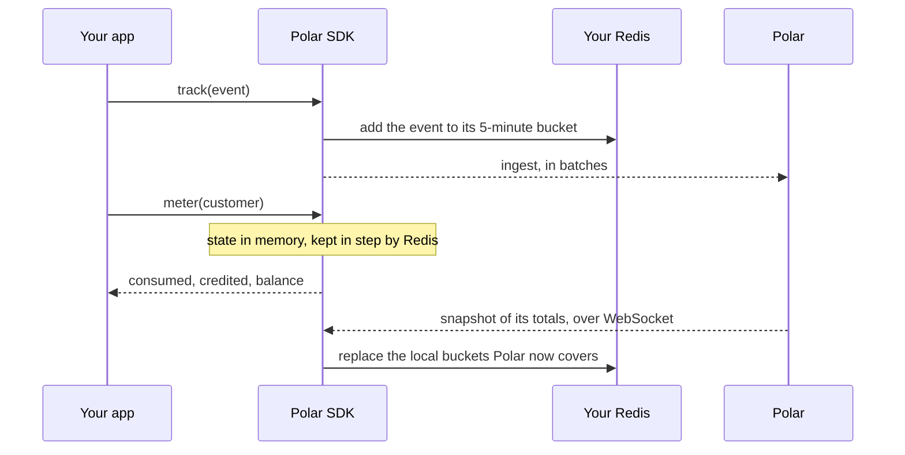

Outpost runs inside the Polar SDK. It keeps a copy of each customer's meter usage in a Redis you own, updates that copy when you track an event, and answers balance reads from it. Polar stays the source of truth: your events still reach it in batches, and it sends its totals back, which replace the local copy.

Use it when your application has to check a balance on every request, and a round trip to Polar on each one is too slow.

## What it promises

- A read sees every event `track()` has returned for, on every instance that shares the Redis.
- A read answers from the instance's memory, kept in step with Redis, in microseconds. It never calls Polar.
- An event counts locally until Polar has stored it, and Polar's totals then replace the local count, bucket by bucket. A local balance is never higher than Polar's.
- A credit reaches local reads within seconds: Polar pushes a snapshot as soon as it records the grant.

## What it leaves to you

- Outpost never refuses an event. Checking the balance before you serve a request is your call, as it is without Outpost.
- Polar's own meter reads lag behind Outpost by the time it takes to ingest the batch. Both converge within minutes.

## How it works



Every instance of your application that runs the SDK with the same Redis shares one state. Redis tells the other instances about each write, so they see it within milliseconds.

## Set it up

<Steps>
  <Step title="Give Outpost a Redis database">
    Outpost needs a Redis reachable from every instance of your application. Give it a database of its own, and one per environment: a sandbox and a production deployment must not share one. Set its URL in `REDIS_URL`, or pass it as an option.
  </Step>
  <Step title="Use an organization access token with events:write">
    Outpost opens a WebSocket to Polar with the token your client uses. The token needs the `events:write` scope, the same one event ingestion needs.
  </Step>
  <Step title="Start Metering">
    Outpost is off by default. Pass `outpost: true` to `polar.metering()`, or `outpost=True` in Python, to turn it on with `REDIS_URL`. Pass an object instead to configure it.
  </Step>
</Steps>

<Tabs>
  <Tab title="TypeScript">
    ```typescript
    import { createPolar } from "@polar-sh/sdk/2026-10";

    const polar = createPolar({ accessToken: process.env.POLAR_ACCESS_TOKEN! });

    await using metering = await polar
      .metering({ outpost: { redisUrl: process.env.REDIS_URL! } })
      .start();
    ```

    | Option      | Default                          | Meaning                                   |
    | ----------- | -------------------------------- | ----------------------------------------- |
    | `redisUrl`  | `REDIS_URL` environment variable | The Redis Outpost uses.                   |
    | `telemetry` | `true`                           | Send Outpost metrics and traces to Polar. |
  </Tab>
  <Tab title="Python">
    ```python
    import os

    from polar.v2026_10 import PolarAsync

    async with PolarAsync(os.environ["POLAR_ACCESS_TOKEN"]) as polar:
        async with polar.metering(outpost={"redis_url": os.environ["REDIS_URL"]}) as metering:
            ...
    ```

    | Option      | Default                          | Meaning                                   |
    | ----------- | -------------------------------- | ----------------------------------------- |
    | `redis_url` | `REDIS_URL` environment variable | The Redis Outpost uses.                   |
    | `telemetry` | `True`                           | Send Outpost metrics and traces to Polar. |
  </Tab>
</Tabs>

## Track and read

Every event needs an `external_id`. Outpost uses it to count an event once, however many times it is tracked or retried, and to settle it once Polar confirms it. `track()` rejects an event without one.

The first read of a customer waits for Polar's snapshot, up to 5 seconds. Warm the customer when the session starts, so the read that matters comes from memory:

<Tabs>
  <Tab title="TypeScript">
    ```typescript
    const actor = await metering.actor({ external_customer_id: "customer_123" });
    await actor.track({ name: "api_request", external_id: "req_42", metadata: { tokens: 42 } });

    const meter = await actor.meter("meter_uuid");
    if (meter !== null && meter.balance <= 0) {
      // Decline the call, switch to a cheaper model, or ask for a top-up.
    }
    ```
  </Tab>
  <Tab title="Python">
    ```python
    actor = await metering.actor(external_customer_id="customer_123")
    await actor.track(name="api_request", external_id="req_42", metadata={"tokens": 42})

    meter = await actor.meter("meter_uuid")
    if meter is not None and meter.balance <= 0:
        ...  # Decline the call, switch to a cheaper model, or ask for a top-up.
    ```
  </Tab>
</Tabs>

A read returns the customer's `consumed_units`, `credited_units` and `balance` for one meter, computed as Polar does: credits minus consumption.

In a serverless runtime, flush `Metering` before each request ends, as the [SDK guide](/integrate/sdk/typescript) explains, so your events reach Polar before the runtime freezes.

## When something is down

**Redis is unreachable.** `track()` and `meter()` fail with `UnavailableRedisError`. The event is already queued for Polar, so nothing is lost; your code decides whether to serve the request without a balance. Outpost reconnects on its own.

**Polar is unreachable.** Reads keep answering, with the last totals Polar sent plus every event tracked since. A first read of a customer Outpost has never seen fails at once, because no snapshot can arrive.

`Metering` retries each batch of events a few times, then reports it to `onDropped`. Polar never bills a dropped event, so once Polar is back, its next snapshot removes it from local reads too.

**An instance restarts.** Nothing to rebuild: the state lives in Redis. A new instance reads it and asks Polar for a snapshot of each customer it touches.

## Telemetry

Outpost sends Polar the latency of local writes and reads, their outcomes, connection events, and the difference between local and Polar totals at each snapshot. Polar uses it to improve Outpost and to see how it runs in your deployment. It holds numbers, meter IDs and customer identities, never your events' metadata. Exports leave a few times a minute, over the same token.

To turn it off, pass `telemetry: false`, or set `POLAR_OUTPOST_TELEMETRY=0`.

## What Outpost stores in Redis

| Key                                                     | Content                                                                        | Lifetime                                   |
| ------------------------------------------------------- | ------------------------------------------------------------------------------ | ------------------------------------------ |
| `outpost:v1:state:<customer>:<reducer>`                 | One hash per customer and meter: Polar's totals, local 5-minute buckets, credits | 24 hours after the last read, write or snapshot |
| `outpost:v1:pending:<customer>:<reducer>:<bucket>`      | The events of a bucket Polar has not confirmed yet                              | 65 minutes after the last write            |
| `outpost:v1:<db>:updates`                               | Pub/sub channel that carries each write to the other instances                  | No storage                                 |

A customer who stops sending events disappears from Redis after a day. A hash holds a few hundred bytes per bucket, and Polar's snapshots fold buckets into one total every five minutes, so a customer costs a few kilobytes.

The `v1` in each key names the layout. A future layout takes a new version and starts from Polar's snapshot; it never reads the previous keys, which expire on their own.
