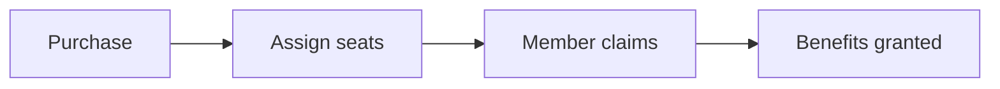

**Seat-based pricing** lets one customer buy a number of seats and assign them to people on their team. Each person who claims a seat gets the product's benefits. Use it for team subscriptions and perpetual team licenses.

For quantities that aren't people, use [unit-based pricing](/features/unit-based-pricing). See [Choosing a quantity-based model](/concepts/products#choosing-a-quantity-based-model).

The code examples use API version `2026-10` and the sandbox.

## Customers, members and seats

Seat-based products separate who pays from who uses:

- The **customer** pays. It owns the subscription or order and the payment methods. On its first seat-based purchase, the customer becomes `type: "team"` for good, which enables members.
- A **member** is a person under that customer, with their own email and a role: `owner`, `billing_manager` or `member`. The buyer becomes the `owner`. Owners and billing managers can manage seats, the subscription and payment methods.
- A **seat** links a member to a subscription or order. Its `status` is `pending`, `claimed` or `revoked`.

Benefits go to members, not to the customer. Always identify the end user by the member on a benefit grant, never by the customer who paid.



<Visibility for="agents">
  Purchase, then assign seats, then members claim, then benefits are granted. Benefits aren't granted at purchase. Use `member` on `benefit_grant.*` and `customer_seat.*` webhooks to identify the end user; `customer_id` is the billing customer.
</Visibility>

### Subscriptions vs one-time purchases

| | Subscription | One-time purchase |
| --- | --- | --- |
| Payment | Every billing period | Once |
| Seats last | While the subscription is active | Forever |
| Adding seats | Increase the seat count | Buy a new order, which has its own seats |
| Benefits | While the subscription is active | Forever after the claim |

## Create a seat-based product

<Steps>
  <Step title="Create a product">
    Open **Catalog** and click **New Product**. Set the name, description and images as usual.
  </Step>
  <Step title="Choose the price type">
    Under **Pricing**, pick **One-time purchase** or **Recurring subscription** (with its **Every** interval), then choose **Seats** as the price type.
  </Step>
  <Step title="Choose a tiering model">
    Under **Tiering model**, pick how seats are priced:

    | Model | Description |
    | --- | --- |
    | **Fixed price per seat** | Every seat costs the same rate |
    | **Volume** | The total seat count sets the rate, and that rate applies to every seat |
    | **Graduated** | Each tier's range is priced at its own rate, and the total is the sum |

    A tier has an upper bound ("up to") and a rate. The bound is inclusive, and each tier starts where the previous one ended. Leave the last bound empty for an open-ended top range.

    With tiers of up to 10 seats at \$10 and beyond at \$8, 14 seats cost:

    - Volume: 14 × \$8 = \$112. Every seat gets the lower rate.
    - Graduated: 10 × \$10 + 4 × \$8 = \$132. Each range keeps its own rate.
  </Step>
  <Step title="Add benefits">
    Attach the benefits each seat holder receives. They're granted when a seat is claimed, not at purchase.
  </Step>
</Steps>

In API version `2026-10`, a seat-based price has `amount_type: "seat_based"` and `seat_tiers`. Each tier has `min_seats`, `max_seats` (`null` for no limit) and `price_per_seat` in cents. The first tier's `min_seats` is the smallest seat count a customer can buy.

<CodeGroup>
```typescript TypeScript
const product = await polar.products.create({
  name: "Team",
  recurring_interval: "month",
  prices: [
    {
      amount_type: "seat_based",
      seat_tiers: {
        seat_tier_type: "volume",
        tiers: [
          { min_seats: 1, max_seats: 10, price_per_seat: 1000 },
          { min_seats: 11, max_seats: null, price_per_seat: 800 },
        ],
      },
    },
  ],
});
```

```python Python
product = polar.products.create(
    name="Team",
    recurring_interval="month",
    prices=[
        {
            "amount_type": "seat_based",
            "seat_tiers": {
                "seat_tier_type": "volume",
                "tiers": [
                    {"min_seats": 1, "max_seats": 10, "price_per_seat": 1000},
                    {"min_seats": 11, "max_seats": None, "price_per_seat": 800},
                ],
            },
        }
    ],
)
```

```bash cURL
curl -X POST https://sandbox-api.polar.sh/v1/products/ \
  -H "Authorization: Bearer $POLAR_ACCESS_TOKEN" \
  -H "Polar-Version: 2026-10" \
  -H "Content-Type: application/json" \
  -d '{
    "name": "Team",
    "recurring_interval": "month",
    "prices": [{
      "amount_type": "seat_based",
      "seat_tiers": {
        "seat_tier_type": "volume",
        "tiers": [
          { "min_seats": 1, "max_seats": 10, "price_per_seat": 1000 },
          { "min_seats": 11, "max_seats": null, "price_per_seat": 800 }
        ]
      }
    }]
  }'
```
</CodeGroup>

<Note>
  API version 2027-01 describes seat prices with the shared `tiers` shape and a `minimum_units` field, like unit-based prices. See [Create Product](/api-reference/next/products/create-product).
</Note>

To charge a base fee on top of the seats, add a `fixed` price to the same product. The customer pays the fixed fee plus the seat charge. See [Combining prices](/concepts/products#combining-prices).

## Sell seats at checkout

The buyer picks the seat count at checkout. When you create a [Checkout Session](/features/checkout/session), you can preset it with `seats`, or bound it with `min_seats` and `max_seats`.

<CodeGroup>
```typescript TypeScript
const checkout = await polar.checkouts.create({
  products: [product.id],
  seats: 5,
  external_customer_id: "user_123",
});
```

```python Python
checkout = polar.checkouts.create(
    products=[product.id],
    seats=5,
    external_customer_id="user_123",
)
```

```bash cURL
curl -X POST https://sandbox-api.polar.sh/v1/checkouts/ \
  -H "Authorization: Bearer $POLAR_ACCESS_TOKEN" \
  -H "Polar-Version: 2026-10" \
  -H "Content-Type: application/json" \
  -d '{
    "products": ["'"$PRODUCT_ID"'"],
    "seats": 5,
    "external_customer_id": "user_123"
  }'
```
</CodeGroup>

When the buyer finishes on Polar's default confirmation page, Polar claims one seat for them right away, so they get the benefits without an invitation email. The remaining seats are free to assign. If you set a custom `success_url`, nothing is claimed automatically: the buyer assigns themselves a seat in the Customer Portal, or you assign it through the API.

## Assign seats

Owners and billing managers assign seats from the [Customer Portal](/features/customer-portal/introduction) while **Settings → Customer Portal → Enable subscription seat management** is on. It's on by default. You can also assign seats yourself:

<Tabs>
  <Tab title="Dashboard">
    - Open **Sales → Subscriptions**
    - Select the subscription
    - Under **Seats**, click **Assign Seat**
    - Enter the member's **Email**
  </Tab>
  <Tab title="CLI">
    ```bash
    polar customer_seats assign_seat --subscription-id <subscription_id> \
      --email jane@example.com
    ```

    See [`polar customer_seats`](/integrate/cli/reference/customer_seats).
  </Tab>
  <Tab title="Prompt">
    ```text Prompt
    Assign a seat on subscription <subscription_id> to jane@example.com in my Polar sandbox.
    ```

    Uses the `customer_seats_assign_seat` operation of the [Polar MCP server](/integrate/mcp).
  </Tab>
</Tabs>

Polar emails the member a claim link. Once they claim the seat, their benefits are granted.

To assign seats from your own app, for example when a user joins a workspace, call the API. Identify the seat holder with `email`, `external_customer_id`, `customer_id`, `member_id` or `external_member_id`. Set `immediate_claim: true` to skip the invitation email and grant benefits right away, when your app already authenticates the user. For a one-time purchase, pass `order_id` instead of `subscription_id`.

<CodeGroup>
```typescript TypeScript
const seat = await polar.customerSeats.assignSeat({
  subscription_id: subscriptionId,
  email: "jane@example.com",
  immediate_claim: true,
});
```

```python Python
seat = polar.customer_seats.assign_seat(
    subscription_id=subscription_id,
    email="jane@example.com",
    immediate_claim=True,
)
```

```bash cURL
curl -X POST https://sandbox-api.polar.sh/v1/customer-seats \
  -H "Authorization: Bearer $POLAR_ACCESS_TOKEN" \
  -H "Polar-Version: 2026-10" \
  -H "Content-Type: application/json" \
  -d '{
    "subscription_id": "'"$SUBSCRIPTION_ID"'",
    "email": "jane@example.com",
    "immediate_claim": true
  }'
```
</CodeGroup>

A seat can carry `metadata`, such as a department or cost center: up to 10 keys and 1 KB in total.

## Manage seats

Open **Sales → Subscriptions** and select the subscription. The **Seats** section shows how many seats are available and lists each seat's **Email** and **Status**.

| Dashboard | API `status` | Meaning |
| --- | --- | --- |
| **Pending** | `pending` | Assigned and invited, not claimed yet |
| **Claimed** | `claimed` | Claimed by the member, benefits granted |
| **Revoked** | `revoked` | Revoked, benefits removed, the seat can be reassigned |

Each seat's **…** menu has the actions:

- **Resend Invitation** for a pending seat. Claim links expire after 24 hours. From the CLI, `polar customer_seats resend_invitation <seat_id>`. In code, `polar.customerSeats.resendInvitation(seatId)`.
- **Revoke Seat** to remove a member's access and free the seat. From the CLI, `polar customer_seats revoke_seat <seat_id>`.

List seats from the CLI with `polar customer_seats list_seats --subscription-id <id>`.

<Warning>
  **Revoking a seat doesn't lower the bill.** It frees the seat for someone else, but the customer still pays for the same seat count. To stop paying for a seat, reduce the seat count.
</Warning>

## Change the seat count

On a subscription, update `seats`. You can't go below the number of assigned seats (pending and claimed). Revoke seats first. Owners and billing managers can also change it in the Customer Portal.

<Tabs>
  <Tab title="Dashboard">
    - Open **Sales → Subscriptions**
    - Select the subscription
    - Click **Update Subscription**
    - Open the **Seats** tab and set **Total seats**
  </Tab>
  <Tab title="CLI">
    ```bash
    polar subscriptions update <subscription_id> --seats 25
    ```
  </Tab>
  <Tab title="Prompt">
    ```text Prompt
    Change subscription <subscription_id> to 25 seats in my Polar sandbox.
    ```

    Uses the `subscriptions_update` operation of the [Polar MCP server](/integrate/mcp).
  </Tab>
</Tabs>

<CodeGroup>
```typescript TypeScript
await polar.subscriptions.update(subscriptionId, { seats: 25 });
```

```python Python
polar.subscriptions.update(subscription_id, seats=25)
```

```bash cURL
curl -X PATCH "https://sandbox-api.polar.sh/v1/subscriptions/$SUBSCRIPTION_ID" \
  -H "Authorization: Bearer $POLAR_ACCESS_TOKEN" \
  -H "Polar-Version: 2026-10" \
  -H "Content-Type: application/json" \
  -d '{ "seats": 25 }'
```
</CodeGroup>

Mid-period changes follow your [proration behavior](/features/subscriptions/proration). Added seats are charged for the rest of the period. Removed seats are credited for the unused part. The full price applies from the next period.

For a one-time purchase, the customer buys a new order. Each order has its own seats.

## Handle benefit grants

Listen for `benefit_grant.created` and `benefit_grant.revoked` to sync access in your app. Read the recipient from `grant.member`. `customer_id` is the billing customer, not the person using the seat.

<CodeGroup>
```typescript TypeScript
import { webhooks } from "@polar-sh/sdk/2026-10";

export async function POST(request: Request) {
  const event = await webhooks.validateEvent(
    await request.text(),
    {
      "webhook-id": request.headers.get("webhook-id") ?? "",
      "webhook-timestamp": request.headers.get("webhook-timestamp") ?? "",
      "webhook-signature": request.headers.get("webhook-signature") ?? "",
    },
    process.env.POLAR_WEBHOOK_SECRET!,
  );

  if (event.type === "benefit_grant.created" && event.data.member) {
    await grantAccess(event.data.member.email, event.data.benefit_id);
  }
  if (event.type === "benefit_grant.revoked" && event.data.member) {
    await revokeAccess(event.data.member.email, event.data.benefit_id);
  }

  return new Response(null, { status: 202 });
}
```

```python Python
import os

from flask import Flask, request
from polar.v2026_10.webhooks import validate_event

app = Flask(__name__)


@app.post("/api/webhooks")
def webhook():
    event = validate_event(
        request.get_data(),
        dict(request.headers),
        os.environ["POLAR_WEBHOOK_SECRET"],
    )

    member = getattr(event.data, "member", None)
    if event.type == "benefit_grant.created" and member:
        grant_access(member.email, event.data.benefit_id)
    if event.type == "benefit_grant.revoked" and member:
        revoke_access(member.email, event.data.benefit_id)

    return "", 202
```
</CodeGroup>

`validateEvent` (`validate_event` in Python) throws if the signature is invalid. See [Webhook delivery](/integrate/webhooks/delivery). Test locally with `polar webhook listen`.

| Event | When |
| --- | --- |
| `order.paid` | The customer completes the purchase |
| `subscription.updated` | The seat count changes |
| `customer_seat.assigned` | A seat is assigned and the invitation sent |
| `customer_seat.claimed` | A member claims their seat |
| `benefit_grant.created` | A benefit is granted to a member |
| `customer_seat.revoked` | A seat is revoked |
| `benefit_grant.revoked` | A benefit is removed from a member |

When a subscription ends, each seat is revoked separately, so expect one `customer_seat.revoked` per seat and one `benefit_grant.revoked` per seat and benefit. Make your handlers idempotent.

## Member sessions

To open the Customer Portal for one member, create a customer session with `member_id` or `external_member_id`. Owners and billing managers see team management: seats, members and seat usage. Members see only their own benefits. See [Customer Portal](/features/customer-portal/introduction).

## Seat metrics

The **Seats** group under **Analytics → Metrics** tracks seat count, claimed and pending seats, seat customers and seat utilization. See [Metrics](/features/analytics#seats).

## Limitations

- Seats are assigned one at a time. To assign many, loop over the API.
- Claim links expire after 24 hours.
- Seat metadata is limited to 10 keys and 1 KB.
- A product can't combine seat-based and unit-based prices.

## From the CLI or your agent

| Task | CLI | MCP operation |
| --- | --- | --- |
| List seats | `polar customer_seats list_seats --subscription-id <id>` | `customer_seats_list_seats` |
| Assign a seat | `polar customer_seats assign_seat` | `customer_seats_assign_seat` |
| Revoke a seat | `polar customer_seats revoke_seat <seat_id>` | `customer_seats_revoke_seat` |
| Resend an invitation | `polar customer_seats resend_invitation <seat_id>` | `customer_seats_resend_invitation` |
| Change the seat count | `polar subscriptions update <id> --seats <n>` | `subscriptions_update` |

## Learn more

| Resource | Description |
| --- | --- |
| [Products & prices](/concepts/products) | Price types and how they combine |
| [Customers](/concepts/customers) | Customers and members |
| [Proration](/features/subscriptions/proration) | How mid-period seat changes are charged |
| [Customer Seats API](/api-reference/current/customer-seats/assign-seat) | Assign, list, revoke and resend seats |
