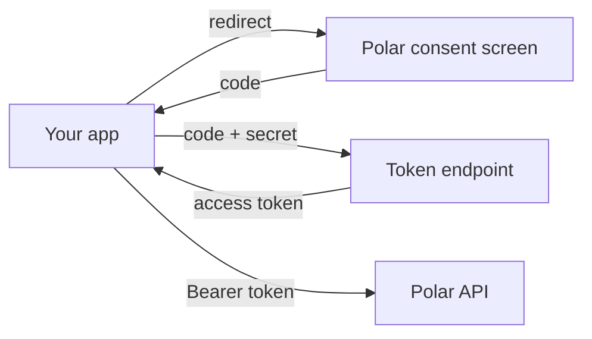

Polar is an **OpenID Connect** provider. OpenID Connect is a standard layer on top of OAuth 2.0: a Polar user signs in to your app, approves the scopes you ask for, and your app gets an access token to call the Polar API on their behalf.

**Do you need it?** Only if you build an app or service for other Polar users, such as an analytics tool or an integration that manages their products. To integrate Polar into your own product, use an [organization access token](/integrate/oat) instead. It's one token, with no sign-in flow.

## How it works

<Visibility for="agents">
  The flow: redirect the user to `/oauth2/authorize`, receive a `code` on your redirect URI, exchange it at `POST /v1/oauth2/token` for an access token (`polar_at_u_…`) and a refresh token, then call the API with `Authorization: Bearer`. Only the authorization code flow is supported.
</Visibility>

1. [Create an OAuth 2.0 client](/integrate/oauth2/setup) to get a Client ID and Client Secret.
2. [Connect users](/integrate/oauth2/connect): redirect them to Polar, exchange the returned code for tokens, and call the API.

## Discovery

The discovery endpoint describes Polar's OpenID Connect server, so compatible client libraries can configure themselves:

| Environment | Discovery URL |
| --- | --- |
| Production | [`https://api.polar.sh/.well-known/openid-configuration`](https://api.polar.sh/.well-known/openid-configuration) |
| Sandbox | [`https://sandbox-api.polar.sh/.well-known/openid-configuration`](https://sandbox-api.polar.sh/.well-known/openid-configuration) |

Clients, users and tokens are separate per environment. Build against the [sandbox](/integrate/sandbox) first.

## Learn more

| Resource | Description |
| --- | --- |
| [Create a client](/integrate/oauth2/setup) | Register your app and get its credentials |
| [Connect users](/integrate/oauth2/connect) | Authorize, exchange the code and refresh tokens |
| [Authentication](/integrate/authentication) | Compare OAuth 2.0 with organization access tokens |
