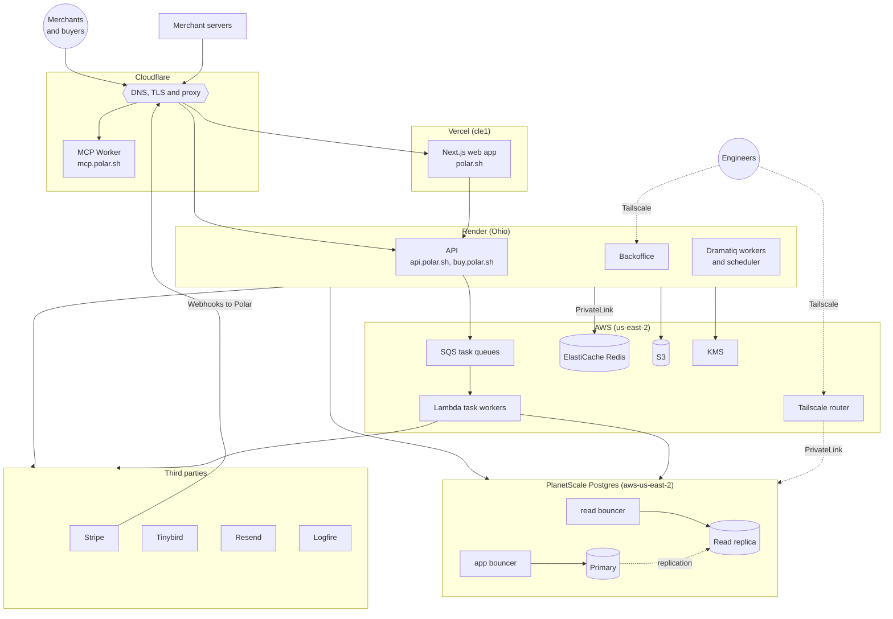

**Last reviewed:** 2026-11-05. Update this page when you add, move or remove a service. The source of truth is [`terraform/`](https://github.com/polarsource/polar/tree/main/terraform).

For what data goes where and which third parties receive it, see [Data Flows](/engineering/data-flows).

## Production

## Components

| Component | Runs on | What it does | Terraform |
| --- | --- | --- | --- |
| Web app | Vercel | Next.js dashboard, checkout and customer portal on `polar.sh` | `modules/vercel` |
| API | Render | FastAPI backend behind `api.polar.sh`. Also serves checkout link redirects on `buy.polar.sh` | `modules/render_service` |
| Dramatiq workers | Render | Background jobs and the scheduler, one service per queue | `modules/render_service` |
| Lambda task workers | AWS | Background jobs consumed from SQS, one queue and function per priority | `modules/aws_task_worker` |
| Postgres | PlanetScale | Primary for writes, a dedicated read replica for reads, both behind PgBouncer | `modules/planetscale_postgres` |
| Redis | AWS ElastiCache | Cache and the Dramatiq broker. Render reaches it over PrivateLink | `modules/aws_redis`, `modules/redis_private_link` |
| S3 | AWS | Uploaded files, invoices, receipts and payout invoices | `modules/s3_buckets` |
| KMS | AWS | Secret encryption and JWKS signing keys | `modules/render_secrets_kms`, `modules/jwks_signing_key` |
| Cloudflare | Cloudflare | DNS for `polar.sh`, proxy and TLS for the API and web app, the MCP Worker | `production/*.tf` |
| Backoffice | Render | Internal admin UI on `backoffice.polar.sh`, reachable only over Tailscale | `modules/render_service` |
| Tailscale router | AWS EC2 | Engineer access to the private VPC, Redis and the database | `modules/ec2_tailscale` |

## Environments

Production, sandbox and test each have their own Terraform workspace in `terraform/production`, `terraform/sandbox` and `terraform/test`. The diagram above shows production. Sandbox and test use the same modules but omit production-only components: the MCP Worker, the dedicated read replica and the backup copy job. Sizes, domains and the number of workers also differ.
