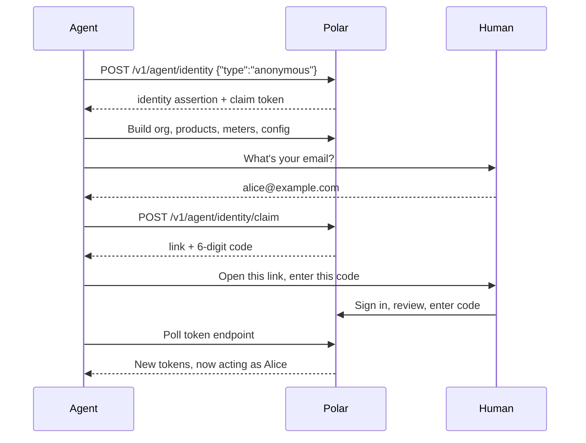

<Info>

**Status**: Draft

**Created**: October 2026

**Last Updated**: Oct 14, 2026

**Author**: Abris Simon
</Info>

## Summary

We want an agent to sign up and work on Polar by itself. When it's done, the human takes ownership with
one link and a 6-digit code.

We do this by implementing the [WorkOS auth.md spec](https://workos.com/auth-md/docs/apps) on top of our
existing OAuth2 server. Agents get ordinary OAuth tokens, so nothing else in the API changes.

## Goals

- An agent can find out how to sign up without a human telling it (discovery).
- An agent can start building (org, products, meters, config) before any human is involved.
- A human takes over the result with one link and a code.
- Before a human claims it, an agent can't touch anything involving real money.

## Out of scope

- **ID-JAG**: identity assertions signed by agent platforms (e.g. "this is Claude, acting for alice@…"), which would skip the claim step. Later, once platforms issue them.
- **Agent Auth Protocol**: see [Options](#options).

## How it works

There are two ways to sign up. Agents pick one by reading our `/auth.md` file.

### 1. Anonymous: build first, claim later

The agent doesn't need anything from the human to start.

1. The agent calls `POST /v1/agent/identity` with `{"type": "anonymous"}` and gets credentials right away.
2. Polar creates a [placeholder user](#placeholder-user) behind the scenes. Everything the agent builds belongs to it.
3. The agent creates the org, products, meters and config.
4. When it's done, it asks the human for their email and starts a claim.
5. The agent gives the human a link and a 6-digit code.
6. The human signs in, sees what was built, and types the code.
7. The org now belongs to the human, and the agent keeps working as them.

### 2. service_auth: claim up front

The agent registers with the user's email. The human approves with the link and code first, then the agent
starts working.

### Placeholder user

A regular row in the `users` table, so it can own orgs, hold memberships and be the user that OAuth tokens
belong to. What makes it different:

- **Marked explicitly**: a new column on `users` (e.g. `kind = agent_placeholder`), not inferred from the email.
- **Unreachable email**: `<random>@anonymous-agent.polar.invalid`. `.invalid` is a reserved domain that can
  never receive mail. The email column is required and unique, so it still needs one.

Rules it follows:

1. **Acts like a user**: owns orgs and memberships, and passes the normal "can this user authenticate" check.
2. **Can never log in**: email code and Google/GitHub login refuse it.
3. **Never receives anything**: no sign-up side effects, no emails (the email sender skips it), no support
   or billing records.
4. **Isn't counted as a person**: excluded from user metrics and analytics, labelled in the backoffice.
5. **Short-lived**: one per anonymous registration. Created at sign-up, soft-deleted when the claim completes
   or the 7-day claim window ends. Once deleted, its leftover access tokens stop working.

### Key pieces

- **Discovery**: how agents find this on their own. Standard OAuth metadata files under `/.well-known/`, a
  pointer to them in the `WWW-Authenticate` header of 401 responses, and a plain-language recipe at `/auth.md`.
- **Claim page**: the dashboard page where the human signs in, reviews what the agent built, and enters the
  code (`/agent/claim`).
- **Identity assertion**: a long-lived signed credential the agent keeps. It trades it for short-lived access
  tokens (the standard "JWT-bearer" grant). This replaces refresh tokens.
- **One OAuth client per agent**: each registration creates its own OAuth client, so we can tell agents
  apart and revoke one without touching the others.

## Changes to the OAuth server

All changes are additions. The authorization endpoint, the consent screen, the existing grants
(authorization code, refresh token, web), token format and token validation stay as they are.

**New grants on `/v1/oauth2/token`**

- **Claim grant** (`urn:workos:agent-auth:grant-type:claim`): the agent polls with its claim token. Until the
  human enters the code, it gets the standard device-flow answers (`authorization_pending`, `slow_down`,
  `expired_token`). After that it gets an access token and an identity assertion. The claim token works once.
- **JWT-bearer grant** (`urn:ietf:params:oauth:grant-type:jwt-bearer`, RFC 7523): the agent sends its identity
  assertion and gets an access token. We check the signature, issuer, type, audience (which must identify this
  authorization server) and expiry, that the registration isn't revoked, and that the assertion wasn't issued
  before the claim. No refresh tokens.

In both grants, the client is taken from the registration the credential belongs to, not from a `client_id`
the caller sends. So an existing OAuth app can't use them, and an agent can only ever get tokens for itself.

**Agent clients**

- One OAuth client per registration: public (no secret), no redirect URIs, and only the two grants above.
- Marked as an agent client, so it can't be mistaken for a normal OAuth app.

**Tokens**

- Agents get the same user access tokens as any OAuth app: same table, same validation, same scope checks.
- The scope comes from the registration. It's narrower before the claim and set to the full agent scope at the
  claim.
- At the claim, the tokens issued before it are revoked.

**Identity assertion**

- A JWT signed with our existing signing key, with its own `type` claim, so it can't be confused with any other
  JWT Polar issues, and vice versa.

**Discovery and revocation**

- The authorization-server metadata (`/.well-known/oauth-authorization-server`) lists the new grants and gains
  an `agent_auth` block (links to `/auth.md` and the sign-up and claim endpoints).
- New `/.well-known/oauth-protected-resource` document (RFC 9728).
- The `WWW-Authenticate` header on 401 responses gains a `resource_metadata` link.
- The revocation endpoint accepts agent clients, which have no secret, for their own tokens.

## Decisions

| Topic | Decision |
|---|---|
| Who the agent is | It acts as the claiming user, like any OAuth app. Its OAuth client carries an "agent" marker so we can attribute actions and list or revoke agents. No separate agent role. |
| What a claim is | A transfer: in one atomic step, the placeholder user's orgs and everything in them move to the claiming user. No identity-verification check at claim time, because claimed or not, the org still has to pass the normal verification before it can be paid out. |
| Before the claim | Build only: orgs, products, meters, benefits, config, test events. No review submission, payouts, checkouts, customers or webhooks. Enforced on the server, with narrower scopes as a second layer. |
| After the claim | Anything the user can do. |
| Org creation by an unclaimed agent | Polar's own billing customer and the Plain support records are created at the claim, not before. Nothing else changes. |
| Rollout | Both sign-up types ship together, starting in sandbox behind a feature flag, and go to production once sandbox abuse data looks fine. |
| Claim window | 7 days. After that we delete the unclaimed org, placeholder user and OAuth client. |
| Identity assertion | Lives 30 days and can be reused until it expires, as the auth.md spec expects. The claim issues a fresh one and invalidates older ones. Revoking the agent stops it immediately. After 30 days the agent signs up again and the human re-approves it. |

## Options

| Option | We pick it? |
|---|---|
| **auth.md on our OAuth2 server**: small, reuses what we have, agents get normal tokens | Yes |
| **API tokens from the dashboard**: today's way, needs a human first | No |
| **Agent Auth Protocol**: stronger, but needs client software on the agent side | No |
| **Agents as org members with their own role**: needs a new kind of identity | Not now |

**API tokens (status quo).** Works, but a human has to sign up, find the settings page and paste a token
before the agent can do anything. That's the problem we're solving.

**[Agent Auth Protocol](https://agentauthprotocol.com)** (by Better Auth and Vercel). Better security: each
agent has its own key and signs every request. But the agent needs extra software (a CLI or MCP server) to
do that, our API would have to be wrapped as "capabilities", there's no Python SDK, and the spec is still a
draft. It doesn't work for us today. We can revisit it later.

**Agents as org members.** An agent would be its own identity with its own role in the org. Cleaner in the
long run, but it means a new identity type across auth, policies and the dashboard. Much bigger. Possible
later, and the agent marker on the OAuth client keeps that door open.

## Security considerations

- **Data in and out**: agents send a name, optionally the user's email, and normal API calls. They receive
  an identity assertion, access tokens, a claim token, and a claim link and code to show the human.
- **Who can access it**: anyone can start an anonymous sign-up, but it only gives access to the new
  placeholder account and what it creates. After the claim, the agent has the claiming user's access, and
  it can be revoked.
- **Data we store**: an agent registration (type, status, agent name, email hint, scopes, claim timestamps,
  link to its OAuth client and user). Claim tokens and codes are stored hashed. Unclaimed registrations and
  everything they created are deleted after 7 days.
- **Risks**:
  - *Old credentials still work after the claim.* Reject identity assertions issued before the claim.
  - *A leaked identity assertion.* It's a bearer credential, so whoever holds it can use it until it's revoked or
    expires. We accept that for now and limit the damage: every exchange is checked against the registration, so
    revoking the agent stops it immediately, access tokens are short-lived, and the assertion expires after 30 days at
    most. Only binding it to a key the agent holds (DPoP) would prevent a stolen copy from working; that's a possible
    later addition, optional for agents that support it.
  - *The agent approves itself* using a browser where the user is already logged in. Require a fresh
    sign-in on the claim page.
  - *Abuse of open anonymous sign-up* (spam orgs, slug squatting). Rate limits, a cap on orgs per agent,
    the 7-day cleanup, and a feature flag to switch it off.

These risks go into the risk register before this document is merged.
