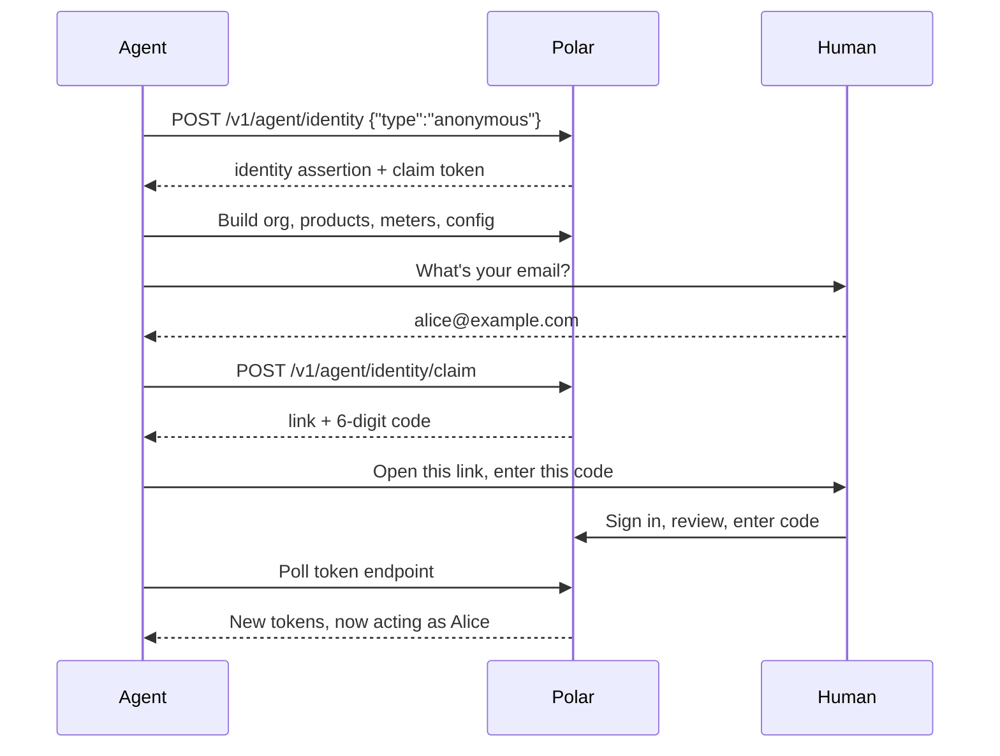

<Info>

**Status**: Draft

**Created**: October 2026

**Last Updated**: Oct 20, 2026

**Author**: Abris Simon
</Info>

## Summary

We want an agent to sign up and work on Polar by itself. When it's done, the human takes ownership with
one link and a 6-digit code.

We do this by implementing the [WorkOS auth.md spec](https://workos.com/auth-md/docs/apps) on top of our
existing OAuth2 server. Before the claim, an agent is its own auth subject that endpoints must opt into
([ADR-0014](/engineering/decisions/0014-agent-auth-subject)). After the claim, it gets ordinary user OAuth
tokens and acts on behalf of the human.

## Goals

- An agent can find out how to sign up without a human telling it (discovery).
- An agent can start building (org, products, meters, config) before any human is involved.
- A human takes over the result with one link and a code.
- Before a human claims it, an agent can't touch anything involving real money.

## Out of scope

- **ID-JAG**: identity assertions signed by agent platforms (e.g. "this is Claude, acting for alice@…"), which would skip the claim step. Later, once platforms issue them.
- **Agent Auth Protocol**: see [Options](#options).

## How it works

There are two ways to sign up. Agents pick one by reading our `/auth.md` file.

### 1. Anonymous: build first, claim later

The agent doesn't need anything from the human to start.

1. The agent calls `POST /v1/agent/identity` with `{"type": "anonymous"}` and gets credentials right away.
2. Polar creates an [agent](#agent-subject) for it: its own auth subject, not a user.
3. The agent creates its org, products, meters and config. The org belongs to the agent.
4. When it's done, it asks the human for their email and starts a claim.
5. The agent gives the human a link and a 6-digit code.
6. The human signs in, sees what was built, and types the code.
7. The human becomes the org's owner, and the agent keeps working on their behalf.

### 2. service_auth: claim up front

The agent registers with the user's email. The human approves with the link and code first, then the agent
starts working.

### Agent subject

The decision and its rules are in [ADR-0014](/engineering/decisions/0014-agent-auth-subject). In short:

- **A row in `agents`**, created at sign-up. It holds the agent's OAuth client, its status, its
  one org and, once claimed, who claimed it. Agents never appear in the `users` table, so login, emails and
  user metrics only ever see people.
- **Its own auth subject**, `Agent`. An unclaimed agent can only reach endpoints whose
  `Authenticator` lists `Agent`; see [Before the claim](#decisions) for which ones.
- **One org per agent**, through an `organization_id` on its row rather than a membership. The org-access helpers
  (`get_accessible_org_ids`, `get_accessible_organization`, `get_payload_organization`, the authz
  policies) resolve the agent to that org, so single-org event ingest and config apply work without an
  `organization_id`. An agent that wants a second org signs up again; parallel sessions are separate agents.
- **A fixed role in its org**: org settings and catalog resources, never members or finance.
- **No human owner until the claim.** Code that looks up an org's owner must handle that.
- **Lifecycle**: created at sign-up. At the claim the human becomes the org's owner, the agent's
  pre-claim credentials are revoked and the row is marked claimed (by whom and when). The row is kept, with
  its `organization_id`: the token endpoint checks it on every exchange, for revocation and to reject
  identity assertions issued before the claim. Unclaimed agents and their orgs are kept too; we can add
  cleanup jobs later if we need them.

### Key pieces

- **Discovery**: how agents find this on their own. Standard OAuth metadata files under `/.well-known/`, a
  pointer to them in the `WWW-Authenticate` header of 401 responses, and a plain-language recipe at `/auth.md`.
- **Claim page**: the dashboard page where the human signs in, reviews what the agent built, and enters the
  code (`/agent/claim`).
- **Identity assertion**: a long-lived signed credential the agent keeps. It trades it for short-lived access
  tokens (the standard "JWT-bearer" grant). This replaces refresh tokens.
- **One OAuth client per agent**: each sign-up creates its own OAuth client, so we can tell agents
  apart and revoke one without touching the others.

## Changes to the OAuth server

The authorization endpoint, the consent screen and the existing grants (authorization code, refresh token,
web) stay as they are. Token validation gains one sub type for unclaimed agents.

**New grants on `/v1/oauth2/token`**

- **Claim grant** (`urn:workos:agent-auth:grant-type:claim`): the agent polls with its claim token. Until the
  human enters the code, it gets the standard device-flow answers (`authorization_pending`, `slow_down`,
  `expired_token`). After that it gets the claiming user's access token and a new identity assertion. The
  claim token works once. The claim link, code and token expire after 7 days; nothing is deleted, and the
  agent can start a new claim.
- **JWT-bearer grant** (`urn:ietf:params:oauth:grant-type:jwt-bearer`, RFC 7523): the agent sends its identity
  assertion and gets an access token. We check the signature, issuer, type, audience (which must identify this
  authorization server) and expiry, that the agent isn't revoked, and that the assertion wasn't
  issued before the claim. Before the claim it returns an agent token; after it, a token for the claiming
  user. No refresh tokens.

In both grants, the client is taken from the agent the credential belongs to, not from a
`client_id` the caller sends. So an existing OAuth app can't use them, and an agent can only ever get tokens for itself.

**Agent clients**

- One OAuth client per agent: public (no secret), no redirect URIs, and only the two grants above.
- Marked as an agent client, so it can't be mistaken for a normal OAuth app.

**Tokens**

- **Before the claim**: OAuth tokens, grants and authorization codes have a new sub type,
  `SubType.agent`, and resolve to the `Agent` subject. Agent access tokens get their own
  prefix (`polar_at_a_`) so they're recognizable in logs and secret scanning. They carry only the scopes of
  the resources an unclaimed agent may use.
- **After the claim**: the same user access tokens as any OAuth app, with the full agent scope: same table,
  same validation, same scope checks.
- At the claim, everything issued before it is revoked: tokens and identity assertions.

**Identity assertion**

- A JWT signed with our existing signing key, with its own `type` claim, so it can't be confused with any other
  JWT Polar issues, and vice versa.

**Discovery and revocation**

- The authorization-server metadata (`/.well-known/oauth-authorization-server`) lists the new grants and gains
  an `agent_auth` block (links to `/auth.md` and the sign-up and claim endpoints).
- New `/.well-known/oauth-protected-resource` document (RFC 9728).
- The `WWW-Authenticate` header on 401 responses gains a `resource_metadata` link.
- The revocation endpoint accepts agent clients, which have no secret, for their own tokens.

## Decisions

| Topic | Decision |
|---|---|
| Who the agent is | Before the claim, its own `Agent` subject ([ADR-0014](/engineering/decisions/0014-agent-auth-subject)). After the claim, it acts on behalf of the claiming user by design, like any OAuth app. Its OAuth client carries an "agent" marker so we can attribute actions and list or revoke agents. |
| What a claim is | In one atomic step, the human becomes the owner of the agent's org and the agent's pre-claim credentials are revoked, so an org is either fully claimed or still unclaimed. The agent's row is marked claimed and kept, and the org and its data stay as they are. Nothing moves between users. No identity-verification check at claim time, because claimed or not, the org still has to pass the normal verification before it can be paid out. |
| Before the claim | Catalog setup only: organizations, products, meters, benefits, discounts, events and config. Checkout sessions and checkout links too, in sandbox and production alike, so the agent can test a checkout: a checkout only takes payment once the org is approved, which can't happen before the claim in production. Never orders, subscriptions, refunds, customers, payouts, review submission, members, webhooks (including config's webhook section) or organization access tokens. In production the org can't go live before the claim; in sandbox it can. Enforced by the endpoint allowlist, pinned by a test, with narrower scopes as a second layer. |
| Orgs per agent | One. A second org means a new sign-up. |
| After the claim | Anything the user can do. |
| Org creation by an unclaimed agent | Skips the steps that need a human owner. At the claim, Polar runs them as if the human had just created the org: Polar's own billing customer and the Plain support records with the human as owner, the `organization.created` job and the analytics event. The human then goes through the usual onboarding (details, payout account, review) in the dashboard. |
| Rollout | Both sign-up types ship together, starting in sandbox behind a feature flag, and go to production once sandbox abuse data looks fine. |
| Unclaimed orgs | Kept, with no automatic cleanup for now. We can add cleanup jobs later if we need them. |
| Claim link and code | Expire after 7 days. Nothing is deleted; the agent can start a new claim. |
| Identity assertion | Lives 30 days and can be reused until it expires, as the auth.md spec expects. The claim issues a fresh one, which only yields the claiming user's tokens, and invalidates older ones. Revoking the agent stops it immediately. After 30 days the agent signs up again and the human re-approves it. |

## Options

| Option | We pick it? |
|---|---|
| **auth.md on our OAuth2 server**: small, reuses what we have, agents get normal tokens | Yes |
| **API tokens from the dashboard**: today's way, needs a human first | No |
| **Agent Auth Protocol**: stronger, but needs client software on the agent side | No |
| **Placeholder user** owning the org before the claim | No ([ADR-0014](/engineering/decisions/0014-agent-auth-subject)) |
| **Agents keep their own identity after the claim**, as org members with their own role | Not now |

**API tokens (status quo).** Works, but a human has to sign up, find the settings page and paste a token
before the agent can do anything. That's the problem we're solving.

**[Agent Auth Protocol](https://agentauthprotocol.com)** (by Better Auth and Vercel). Better security: each
agent has its own key and signs every request. But the agent needs extra software (a CLI or MCP server) to
do that, our API would have to be wrapped as "capabilities", there's no Python SDK, and the spec is still a
draft. It doesn't work for us today. We can revisit it later.

**Placeholder user.** A fake `User` with an unreachable email would own the org until the claim. No new
subject, but non-people in the users table and guards on login, emails, metrics and every endpoint that
must stay off-limits. Replaced by the `Agent` subject ([ADR-0014](/engineering/decisions/0014-agent-auth-subject)).

**Agents as org members.** After the claim, an agent would keep acting as itself, with its own role in the
org, instead of on behalf of the user. The `Agent` subject is the foundation for this, but it would mean
every user endpoint opting in and agent membership in the dashboard. Possible later.

## Security considerations

- **Data in and out**: agents send a name, optionally the user's email, and normal API calls. They receive
  an identity assertion, access tokens, a claim token, and a claim link and code to show the human.
- **Who can access it**: anyone can start an anonymous sign-up, but it only gives access to the agent's own
  org, through the endpoints opened to unclaimed agents. After the claim, the agent has the claiming user's access, and
  it can be revoked.
- **Data we store**: an `agents` row (type, status, agent name, email hint, scopes, claim timestamps,
  links to its OAuth client, its org and the user who claimed it). Claim tokens and codes are stored hashed.
  Unclaimed agents and everything they created are kept for now, with no automatic cleanup.
- **Risks**:
  - *Old credentials still work after the claim.* Revoke pre-claim tokens and reject identity assertions
    issued before the claim.
  - *An endpoint is opened to unclaimed agents by mistake.* A test pins the routes that accept
    `Agent`, so every opt-in shows up in review, and pre-claim scopes block resources with their own
    scope.
  - *An unclaimed agent creates an organization access token* and escapes the allowlist. Creating one stays
    limited to users.
  - *A leaked identity assertion.* It's a bearer credential, so whoever holds it can use it until it's revoked or
    expires. We accept that for now and limit the damage: every exchange is checked against the agent's row, so
    revoking the agent stops it immediately, access tokens are short-lived, and the assertion expires after 30 days at
    most. Only binding it to a key the agent holds (DPoP) would prevent a stolen copy from working; that's a possible
    later addition, optional for agents that support it.
  - *The agent approves itself* using a browser where the user is already logged in. Require a fresh
    sign-in on the claim page.
  - *Abuse of open anonymous sign-up* (spam orgs, slug squatting). Every sign-up creates a new OAuth
    client, so per-client rate limits don't help: limit per agent and limit sign-ups per IP. Plus one org per
    agent, a feature flag to switch it off, and cleanup jobs later if spam orgs pile up.

These risks go into the risk register before this document is merged.
