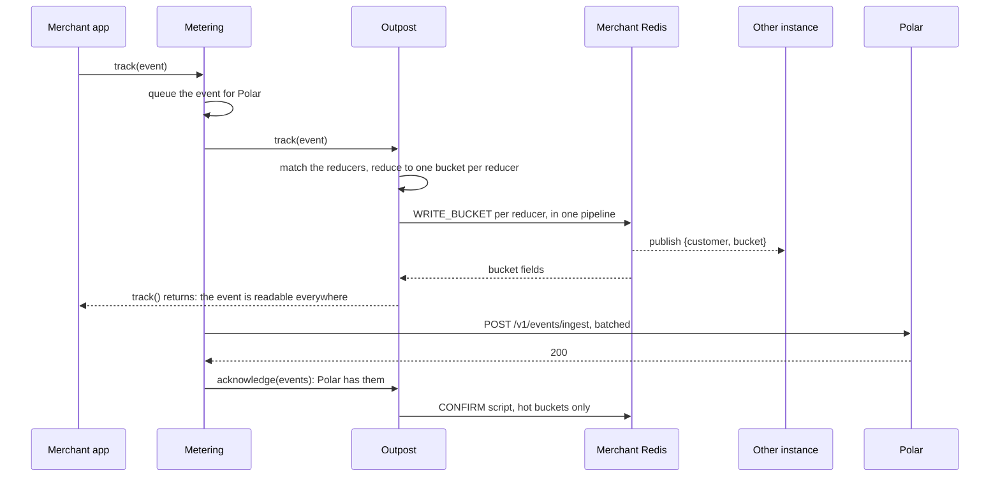
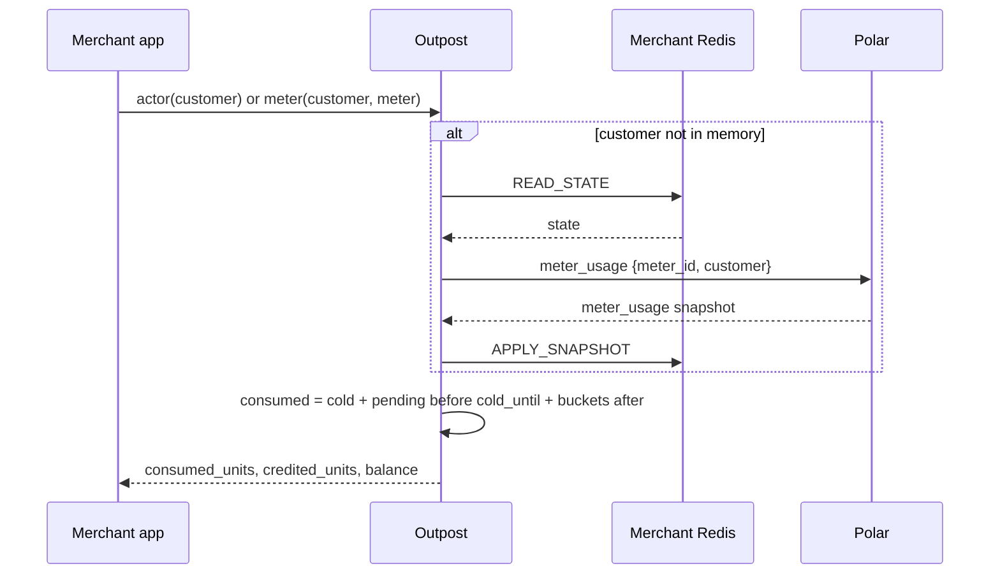
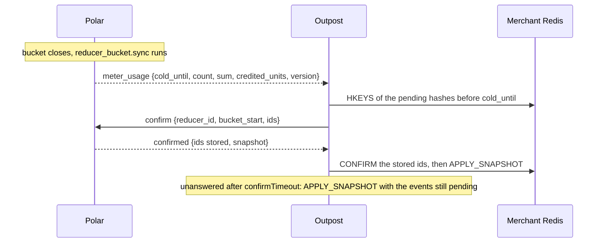

<Info>

**Created**: 2026-10-23

**Last Updated**: 2026-10-23

**Author**: Maxime Bourdon
</Info>

## Summary

Outpost lets a merchant read a customer's meter balance from a Redis they own, right after they track an event, without a request to Polar. The SDK reduces each event into 5-minute buckets in Redis with Lua scripts, every instance of the merchant's application shares that state through Redis pub/sub, and Polar sends snapshots of its own totals over a WebSocket. A snapshot replaces the local buckets it covers; the events Polar has not stored yet stay counted as pending. Polar remains the source of truth for billing.

This document describes what ships in the SDKs today (TypeScript and Python, both built from the same Lua scripts), the Polar side that serves them, and the failure modes.

## Context

Merchants who bill by usage check a balance before they serve a request. Polar's meter reads come from the database and lag ingestion by seconds; an HTTP round trip per request is too slow and too many requests for the rate limit. The SDK already batches events for ingestion. Outpost adds the read side: a local copy of the usage, true to the event, that Polar corrects.

## Current state

### Components

| Component | Where | Role |
|---|---|---|
| `Outpost` client | `sdk/typescript/src/outpost`, `sdk/python/polar/outpost` | Reduces events into Redis, serves reads, applies snapshots, relays telemetry. `polar.metering()` returns a `Metering`, which batches events for ingestion; with `outpost` set, it starts one `Outpost`, which holds the Redis connections and the WebSocket for every event and read that go through that `Metering`. |
| Lua scripts | `sdk/generator/outpost/*.lua`, copied byte for byte into both SDKs | `READ_STATE`, `WRITE_BUCKET`, `CONFIRM`, `APPLY_SNAPSHOT`. Every change to the state is one script call. |
| Merchant's Redis | The merchant's own | Holds one hash per customer and reducer, one pending hash per bucket, one pub/sub channel. |
| Reducers | `server/polar/reducer` | Polar's own 5-minute buckets per meter and customer: hot in Polar's Redis, synced to `reducer_buckets` in Postgres at bucket close, sealed before billing. |
| Outpost WebSocket | `server/polar/outpost`, `GET /v1/outpost/` | Sends the reducer configuration, answers snapshot and confirmation requests, pushes a snapshot when a customer's bucket syncs, takes a late event, or when the customer meter is recomputed, which a credit grant triggers. |
| Telemetry relay | `POST /v1/outpost/telemetry`, `/telemetry/metrics` | Forwards the SDK's OTLP traces and metrics to Logfire, tagged with the organization. |

### The state in Redis

Keys carry the layout version, `v1` today. A new layout takes the next version, starts from Polar's snapshot and never reads the previous keys.

| Key | Content | Lifetime |
|---|---|---|
| `outpost:v1:state:<identity>` | A hash: see the fields below | 24 h after the last script touched it |
| `outpost:v1:pending:<identity>:<bucket_start>` | A hash: `external_id` to the event's value, or empty for a count | 65 min after the last write |
| `outpost:v1:<db>:updates` | Pub/sub channel: `{customer, bucket}` after a write, `{customer, state}` after a confirmation or a snapshot | No storage |

`<identity>` is `external:<external_customer_id>:<reducer_id>` or `customer:<customer_id>:<reducer_id>`. Bucket starts are microseconds since the epoch, floored to 5 minutes.

| Field of the state hash | Meaning |
|---|---|
| `epoch`, `revision` | Identity of this copy of the state and its change counter. A reader applies a bucket update only on top of the revision just before it; otherwise it reloads the whole hash. |
| `cold_until` | Start of the first bucket Polar's totals do not cover yet. |
| `snapshot_version` | Database time of the last snapshot applied; the script ignores an older one. |
| `cold:count`, `cold:sum`, `cold:min`, `cold:max` | Polar's totals for everything before `cold_until`. |
| `bucket:<start>:count`, `…:sum`, `…:min`, `…:max` | Every local event of the bucket. |
| `pending:<start>:count`, `…:sum`, `…:min`, `…:max` | The part of the bucket Polar has not confirmed. |
| `credited:<meter_id>`, `credited_version:<meter_id>` | The customer's credits on the meter, from the last snapshot. |

A read computes consumption as Polar's totals, plus the pending part of the buckets before `cold_until`, plus every local event of the buckets from `cold_until` on. The balance is credits minus consumption.

### The scripts

| Script | Keys | What it guarantees |
|---|---|---|
| `READ_STATE` | state | Creates the hash with a fresh `epoch` if missing, refreshes its TTL, returns it whole. |
| `WRITE_BUCKET` | state, pending | One event per call. Adds it to its bucket and to the pending part, once per `external_id`: a retry or a duplicate changes nothing. Bumps `revision`, publishes the bucket's fields only, which every instance applies in place. |
| `CONFIRM` | state, pending | Settles a list of `external_id`s: drops them from the pending hash and from the pending statistics. With the hot-only flag, it skips a bucket before `cold_until`. It drops a cold bucket whose pending part empties, since Polar's totals already count it. Publishes the whole state. |
| `APPLY_SNAPSHOT` | state | Ignores a snapshot older than the applied one. Replaces `cold:*` with Polar's totals up to the new `cold_until`, drops the local buckets before it, keeps a bucket that still has pending events, for an hour at most. Sets the credits. Returns the fields it replaced, for the drift report. |

### Write path

A hot bucket, at or after `cold_until`, counts its events whole, so an acknowledged event just stops being pending. A cold bucket keeps its events pending until a snapshot counts them: Polar received them, but its totals may not include them yet.

A batch ends in one of two ways, whatever the number of attempts it took. A failed attempt changes nothing in Redis.

- **Delivered**, on any attempt: `Metering` calls `acknowledge`, as above.
- **Dropped**, after `maxAttempts` failed deliveries or on an error a retry cannot fix: `Metering` reports the batch to `onDropped` and calls `confirm` on its events, everywhere, hot or cold. They are no longer pending, Polar will never count them, and the next snapshot replaces the bucket without them.

### Read path

The first read of a customer waits for the snapshot up to `snapshotTimeout` (5 s by default), then reports `not_ready` and the read fails. Later reads serve from memory. The memory copy follows Redis through the channel: a bucket update applies in place when its revision is the next one, anything else reloads the hash.

### Snapshots, syncs and seals

Polar reduces every event it ingests into the same 5-minute buckets. The current bucket lives in Polar's Redis; `reducer_bucket.sync` writes it to Postgres when it closes, and a late event lands in its closed bucket in Postgres at ingest. Both publish a `reducer_bucket` event, as does a customer meter recomputed after a credit grant, and the WebSocket handler answers it with a snapshot for that customer. Billing seals a customer's buckets eleven minutes after its cutoff, once every event has reached Postgres; a sealed bucket is billed as it stands, and an event that arrives later starts a new generation of it.

A snapshot's `cold_until` is the end of the last bucket Polar has fully synced, looking back an hour at most. `count`, `sum`, `min` and `max` cover everything before it, read from Postgres in the same transaction as the confirmed ids, so they count exactly those. The SDK asks Polar which of its pending events the snapshot counts before it applies it; the ones Polar has not stored stay pending, and keep adding to the balance, for an hour at most.

### Telemetry

The SDK records one histogram per local write and read (`outpost.ingest.duration`, `outpost.read.duration`, with the outcome), a counter of buckets written, a span per report of syncs received and applied, spans for connections and reconnections, and a span per snapshot with the local and Polar totals it replaced (`outpost.snapshot.received`). Every record names the meter and the customer identity, never an event's metadata. The SDK exports every 30 seconds through the relay, which forwards to Logfire with the organization and the SDK version. The `outpost` dashboard in the `polar` Logfire project reads them. `telemetry: false` or `POLAR_OUTPOST_TELEMETRY=0` turns it off.

## Goals

- A read sees every event `track()` returned for, on every instance that shares the Redis.
- A read costs no request to Polar, and well under a millisecond on a warm customer.
- A local balance is never higher than Polar's: local consumption counts Polar's totals plus every event Polar has not counted yet. It converges to Polar's own reads.
- Both SDKs behave the same: the Lua scripts are shared, and the client logic is mirrored and tested the same way.

## Failure modes

| Situation | What happens | What the merchant sees |
|---|---|---|
| Redis unreachable | `track()` and `meter()` raise `UnavailableRedisError` at once; the client reconnects with a backoff from 100 ms to 2 s and reloads every cached state once back. The event is already queued for Polar. | Writes and reads fail until Redis is back; nothing is lost. |
| Polar unreachable | The WebSocket reconnects with a backoff; the client requests the configuration again, and each customer's snapshot the next time it touches that customer. Reads keep serving from the last totals plus local events. | Reads work; a first read of an unknown customer fails at once. |
| Polar behind on ingestion | A snapshot counts fewer events than the local buckets; the ones still pending keep adding to the balance. Polar's next snapshot catches up. | Nothing: the local balance stays correct. |
| Late events into a closed bucket | Counted locally as pending; Polar adds them to the closed bucket and sends a new snapshot. | Nothing: the local balance includes them at once. |
| Duplicate or retried event | `HSETNX` on the pending hash makes the second write a no-op. | Nothing: the event counts once. |
| State expired after 24 h idle | The next read creates the hash and asks for a snapshot. | One cold read. |
| Instance restart | Nothing to rebuild: the state is in Redis. | Nothing: reads and writes resume on the shared state. |
| Polar's Redis down at ingest | Polar logs the failed hot-bucket update and still stores the events; the next sync recomputes the bucket from Postgres. | Nothing: snapshots are read from Postgres, which has the events. |
